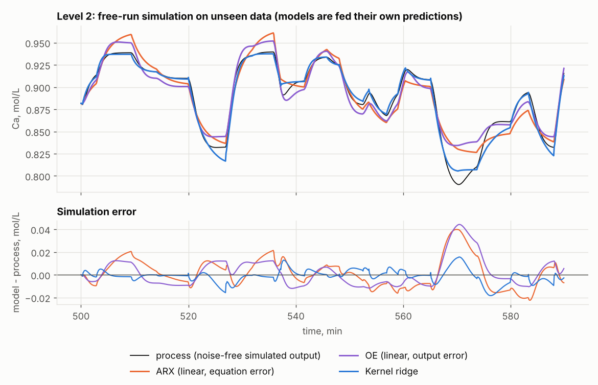
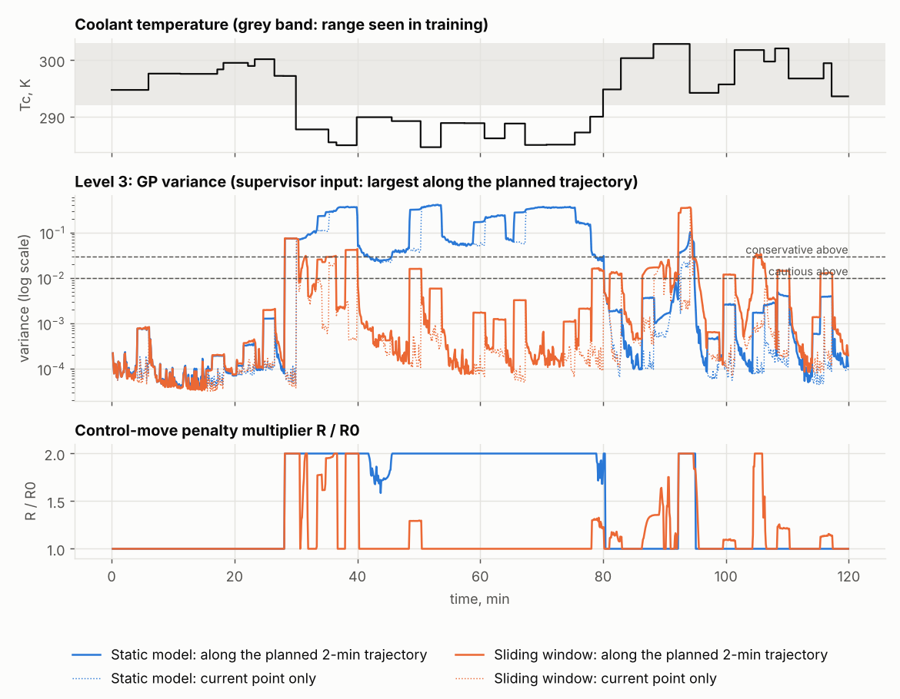
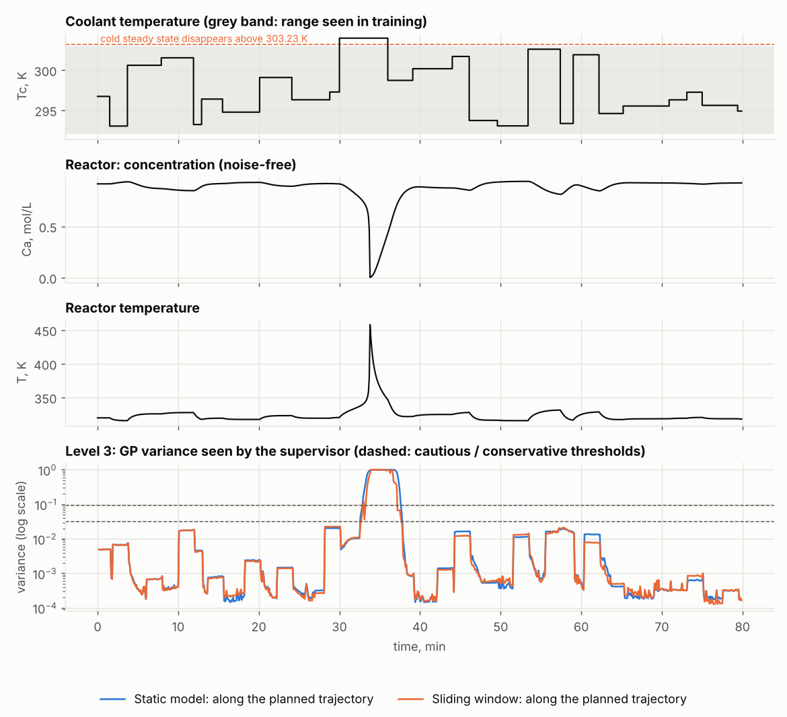
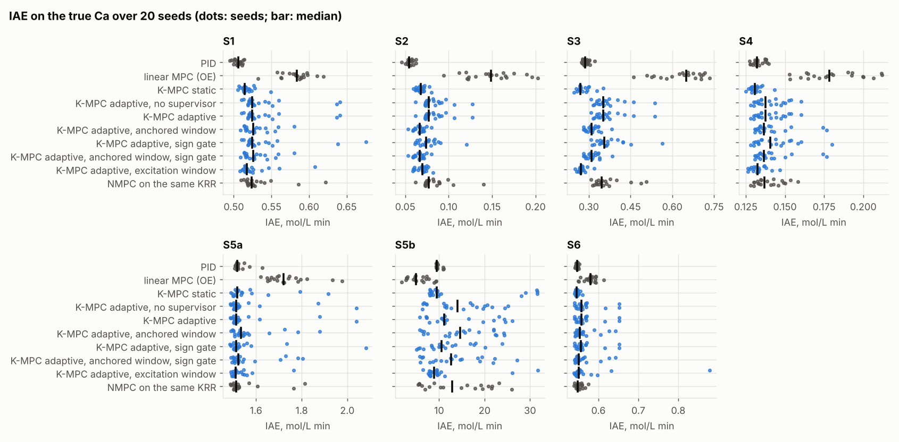

# Adaptive kernel model of a nonlinear reactor (CSTR) in Python

A complete example of process identification with a three-level kernel architecture:
from a raw plant-style log to a validated nonlinear model that rejects bad measurements,
follows slow drift and knows where it can be trusted.

**Process.** Continuous stirred-tank reactor with an exothermic reaction A -> B, a standard
textbook benchmark (Henson & Seborg, *Nonlinear Process Control*, 1997). Input: coolant
temperature. Output: concentration of A. The process gain changes several-fold across the
operating range (19-fold between 292 and 303 K), so a single linear model cannot describe it.
Near the top of the range the reactor has three steady states, and the low-temperature one
disappears at Tc = 303.23 K, 0.23 K above the identified range (see "Scope").

**Architecture.** Three kernel methods share one RBF kernel, each with its own job:

| Level | Method | Job |
|---|---|---|
| 1 | Support vector regression (SVR) | rejects anomalous measurements before they reach the model |
| 2 | Kernel ridge regression (KRR) on a sliding window | the process model; refitted as new data arrive |
| 3 | Gaussian process (GP) variance | checks whether the trajectory planned over the next 2 min runs through known data and raises the penalty on control moves |

KRR is written out in NumPy (`kernel.py`). The Cholesky factorisation of the fitted model gives
its coefficients, the exact leave-one-out residuals and the GP variance; the gradient is in
closed form too. The tuning grid uses one eigendecomposition per kernel width for all
regularisation values.

**What the script does**

1. Simulates an identification experiment with noise, spikes and a logger gap.
2. Start-up on historical data: cleans it with the filter, tunes the kernel in two stages (exact
   leave-one-out, then free run on a held-out block of the start-up data) and calibrates the anomaly
   threshold on out-of-sample residuals.
3. Tests the filter and the model on unseen data; compares with linear ARX and OE models in free-run simulation.
4. Runs a slow-drift scenario (catalyst deactivation) with and without each level; the main measure is
   the free run of each quarter by the model frozen at its start.
5. Runs an excursion below the training range and one above it, past the stability limit, and shows
   the supervisor's reaction; computes the stability limit under parameter changes and tests a lower
   bound on Ca as an ignition guard.
6. Checks the closed-form results numerically and writes `outputs/report.md`.
7. `run_seeds.py` repeats everything over 20 seeds and adds the spread to the report.

**Run**

    pip install -r requirements.txt     # Python 3.13; the versions of the reference run
    python run_demo.py                  # one seed, about 6 minutes (one BLAS thread, as in run_seeds.py)
    python run_seeds.py                 # 20 seeds, about 60 minutes on 2 cores
    python run_demo.py --data log.csv   # your own log (t_min, Tc_K, Ca_mol_L): steps 2-3 and 6
    python -m unittest discover -s tests   # unit tests of parts 1 and 2, under a minute

A supplied log is checked before anything is fitted: the three columns; no gaps in t_min or Tc_K
(gaps in Ca are allowed); a uniform time grid (the sampling period is taken from t_min); Ca recorded
with a step finer than its noise; and a start-up block (first 62.5 %) that leaves at least 1000
clean rows for threshold calibration after the first 1000-sample window. That needs at least
3204 samples, more when the log has spikes or gaps; a shortfall is reported with the length needed.

**Files**

| File | Purpose |
|---|---|
| `cstr.py` | reactor equations, simulator, steady states and stability limit |
| `data.py` | simulated plant logs, noise estimate, reference detectors |
| `kernel.py` | RBF kernel, KRR, exact leave-one-out, gradient, GP variance |
| `adaptive.py` | SVR filter, sliding window, GP supervisor, online loop |
| `pipeline.py` | start-up, tuning, threshold calibration, reference models, scoring |
| `checks.py` | numerical self-checks |
| `tests/test_core.py` | unit tests: stability limit, leave-one-out, filter state machine, supervisor, log checks |
| `figures.py`, `report.py` | figures and report template |
| `run_demo.py` | the scenarios |
| `run_seeds.py` | the scenarios over many seeds |
| `safety.py` | Part 2: ignition limit Tc_max over the admissible parameter set |
| `mpc.py` | Part 2: K-MPC (linearisation, sensitivity G, QP, OSQP, fallback) |
| `controllers.py` | Part 2: PID (SIMC), linear MPC, NMPC on the KRR, oracle NMPC |
| `closed_loop.py` | Part 2: plant, measurement faults, identifier in the loop, scenarios S0-S6, metrics |
| `run_mpc.py`, `run_mpc_seeds.py` | Part 2: one seed with figures; 20 seeds |
| `report_mpc.py`, `check_mpc_independent.py`, `diagnose_mpc.py` | Part 2: report and README section; independent checks; S3 diagnostic |
| `tests/test_mpc.py`, `tests/mutate_mpc.py` | Part 2: unit tests; mutation check |

**Results** (`outputs/report.md`; errors in mol/L, sensor noise 0.002; reference run = seed 0;
spread = median [25th; 75th percentile] over seeds 0-19)

| Test | Reference run | 20 seeds |
|---|---|---|
| Free-run RMSE on unseen data: kernel / linear OE / linear ARX | 0.0043 / 0.0100 / 0.0121 | 0.0046 / 0.0092 / 0.0112 |
| Free-run RMSE ratio, linear OE / kernel | 2.3 | 1.94 [1.61; 2.04] |
| Anomaly filter on unseen data, real time: precision / recall | 0.83 / 1.00 | 0.82 [0.71; 0.87] / 0.98 [0.97; 1.00] |
| Same, causal rolling median calibrated the same way | 0.83 / 0.72 | 0.81 [0.72; 0.88] / 0.77 [0.75; 0.80] |
| Normal samples rejected (target 0.5 %): real time / after restoring process changes | 0.37 % / 0.27 % | 0.4 % [0.3; 0.8] / 0.2 % [0.1; 0.3] |
| One-step error without / with the filter | 0.0031 / 0.0017 | ratio 1.66 [1.48; 1.81] |
| Slow drift, free run of the last quarter: static model / sliding window (both filtered) | 0.0286 / 0.0083 | ratio 3.49 [3.26; 3.85] |
| Excursion below the range, sliding window: warning before the input returns | 18 samples, the most the 20-sample horizon allows | at the first opportunity in 19 of 20 seeds |
| Beyond the stability limit, sliding window: warning at least 1 min before Ca leaves the start-up range | no (2 samples before) | 11 of 20 seeds |
| Ordinary operation, sliding window: warning at the first opportunity before an input change | 7 of 88 changes | 118 of 1698 changes (6.9 %) |

"Real time" counts each filter decision as it was taken, i.e. what a controller receives; a run
of 4 rejections is later recognised as a process change and restored.





**Scope.** Simulation study on a textbook process; not plant data. The supervisor's
penalty multiplier is used by the model-predictive controller of Part 2 (below). At 304 K the reactor ignites (in the reference run the
temperature rises from 323 to 465 K). With the sliding window the GP supervisor warned at least
1 min before Ca left the start-up range in 11 of 20 seeds (in ordinary operation it warns
at the first opportunity before 7 % of input changes), and a warning only raises the move
penalty, so the controller needs hard constraints. Part 2 uses a hard upper bound on Tc that covers
only a named set of parameter deviations; the part 1 findings behind that choice (report, section 4):

- a fixed bound on Tc is not reliable: 5 % less heat transfer moves the stability limit from
  303.23 to 301.55 K, inside the identified range;
- a lower bound on Ca is not reliable either: Ca at the limit rises with the feed concentration,
  and a 3.85 % rise of Caf (1.46 % together with 10 % less heat transfer) is enough for
  Ca >= 0.79 mol/L to admit inputs at which the cold steady state no longer exists;
- Ca is a late indicator: with 10 % less heat transfer, full cooling started 0.3 min after Ca
  falls to 0.79 keeps the reactor at 341 K, started 0.5 min after it does not (peak 471 K);
- during a fast fall the filter replaces up to 3 samples in a row by predictions before it
  recognises a process change, and such runs repeat: 12 samples per ignition, with Ca overstated
  by up to 0.46 mol/L (medians over seeds, sliding window); protective constraints need the raw
  measurement.

<!-- part2:start (generated by report_mpc.py) -->

## Part 2: K-MPC

Predictive control of Ca through Tc on the kernel model of part 1, in closed loop with the three-level identifier. At every step the window KRR is linearised along the shifted previous plan and a convex QP is solved (OSQP). Simulation only; the report is `outputs/report_mpc.md`.

```
y_meas -> SVR filter -> y_rt -> KRR window (refit) -> linearise along plan -> QP (OSQP) -> Tc
                                     |                                         ^
                                     +-> GP variance on the plan -> penalty on heating moves
hard limits on Tc (box + rate) in every controller; fallback: shifted plan, clipped
```

**Safety.** Hard limits 292 K <= Tc <= 300.547 K and |dTc| <= 1 K per step in every controller. Tc_max is the lowest saddle-node point over the admissible set (UA -5..0 %, Tf -1..+1 K) minus 0.5 K; reachable set-points with the nominal plant 0.8682..0.9435 mol/L.

**Results** (median over 20 seeds, true Ca; spread and worst seeds in the report)

| Measure | PID | linear MPC (OE) | K-MPC static | K-MPC adaptive | K-MPC adaptive, anchored window | NMPC on the same KRR |
|---|---|---|---|---|---|---|
| S1, set-point steps: IAE, mol/L min | 0.5059 | 0.5837 | 0.5144 | 0.5246 | 0.5258 | 0.5240 |
| S2, disturbances: IAE, mol/L min | 0.0546 | 0.1486 | 0.0677 | 0.0772 | 0.0664 | 0.0769 |
| S3, k0 drift: IAE, mol/L min | 0.2860 | 0.6492 | 0.2694 | 0.3523 | 0.3093 | 0.3457 |
| S1: total variation of Tc, K | 180.4 | 280.2 | 67.5 | 71.3 | 70.3 | 67.6 |

- Constraint violations: 0 in 1040 runs over 20 seeds.
- Ignition inside the admissible set (S1, S2, S3, S4, S5a, S6), static and adaptive K-MPC: K-MPC static: 0 runs; K-MPC adaptive: 0 runs; highest T 330.4 K.
- S2 steady-state error within 0.001 mol/L (the acceptance limit): static K-MPC on 20 of 20 seeds (worst 0.0008), adaptive K-MPC on 12 of 20 (worst 0.0053 mol/L): **the requirement is not met by the adaptive K-MPC.**
- Step time, 95th percentile, one BLAS thread: K-MPC adaptive 4.8 ms (median over runs, highest 7.3), NMPC on the same KRR 42.2 ms.
- S1: K-MPC adaptive has a lower IAE than NMPC on the same KRR on 3 of 20 seeds (median ratio 1.005); a smaller total variation of Tc than PID on 20 of 20 (median ratio 0.391).
- S3 (drift): adaptive K-MPC has a lower IAE than static K-MPC on 0 of 20 seeds (median ratio 1.247). The configuration with an anchored window (500 of 1000 start-up rows kept) was added after the S3 result of seed 0; its row count was set without tuning.
- Outside the admissible set (S5b: UA -10 %, Caf +5 %) the reactor ignites: PID 20 of 20, linear MPC (OE) 15 of 20, K-MPC static 20 of 20, K-MPC adaptive, no supervisor 20 of 20, K-MPC adaptive 20 of 20, K-MPC adaptive, anchored window 20 of 20, NMPC on the same KRR 20 of 20.

**Limitations.** The adaptive K-MPC does not meet the zero steady-state error requirement in S2 on every seed (above). Simulation of a textbook process. Protection holds only inside the admissible set named above. No stability guarantee: the results are empirical, for these scenarios and seeds. T is not measured. Step times are for the machine in the report.

**Basis.** Part 2 is a separate study on this reactor. From the PhD thesis (see Background) it takes: a kernel (KRR) model of the process, linearised at every step so that control reduces to a convex QP (K-MPC); the three-level architecture on one kernel: SVR filter, KRR on a sliding window, GP supervisor; the supervisor raises the penalty on input moves when the planned trajectory leaves the data; compensation of an unmeasured disturbance through the prediction error. Everything else is designed and tuned for this process.

**Run**

    python run_mpc.py --tune      # S0: rho, beta, PID (outputs/mpc_tuning.json; already frozen)
    python run_mpc.py             # seed 0, all controllers incl. the oracle, figures
    python run_mpc_seeds.py       # 20 seeds (outputs/mpc_seeds.json), several hours on 2 cores
    python report_mpc.py          # outputs/report_mpc.md, fig6_seeds.png, this section
    python tests/mutate_mpc.py    # mutation check of the part 2 tests



<!-- part2:end -->

**Background.** The three-level architecture (SVR filter, sliding-window KRR, GP supervisor
on one shared kernel) comes from my PhD thesis, where it was developed for iron-ore magnetic
separation. This repository is a new implementation on an open textbook process; it contains
no code or data from the thesis. Changes made for a dynamic process are listed in the report.

- O. Volovetskyi. *Predictive Control of a Nonlinear Magnetic Separation Process Based on
  Kernel Functions.* PhD thesis, Kryvyi Rih National University, 2026.
- O. Volovetskyi. Local Linearization of Kernel Models in Real Time as a Basis for Fast
  Optimization in MPC. *Automation of Technological and Business Processes*, 17(4), 98-103,
  2025. DOI: 10.15673/atbp.v17i4.3319
- O. Volovetskyi. Utilizing Gaussian Process Regression for Nonlinear Magnetic Separation
  Process Identification. *IAPGOS*, 14(3), 21-28, 2024. DOI: 10.35784/iapgos.5954
- O. Volovetskyi. Methods of Filtering and Regression for Forecasting Noisy Timeseries Based
  on Machine Learning. *Herald of Advanced Information Technology*, 8(1), 13-27, 2025.
  DOI: 10.15276/hait.08.2025.1

**License.** MIT.
