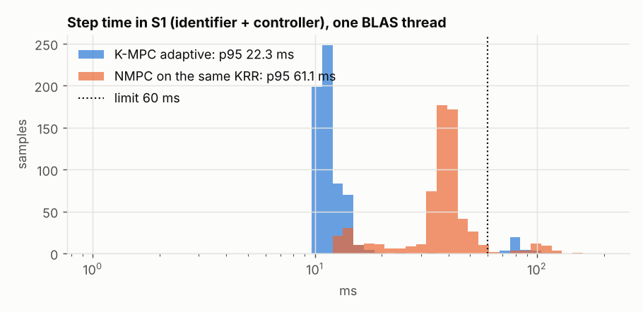
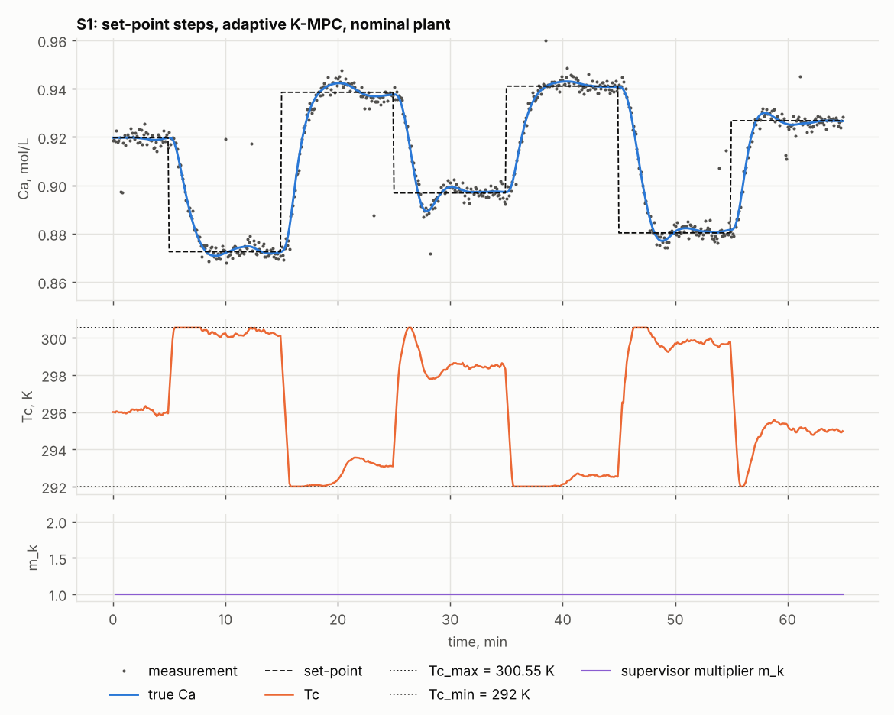
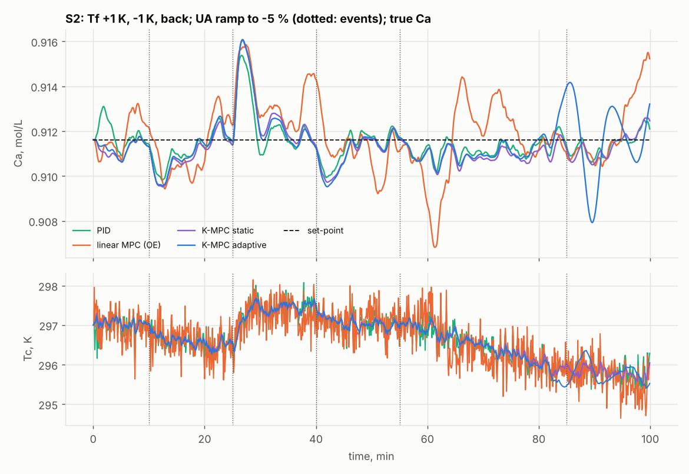
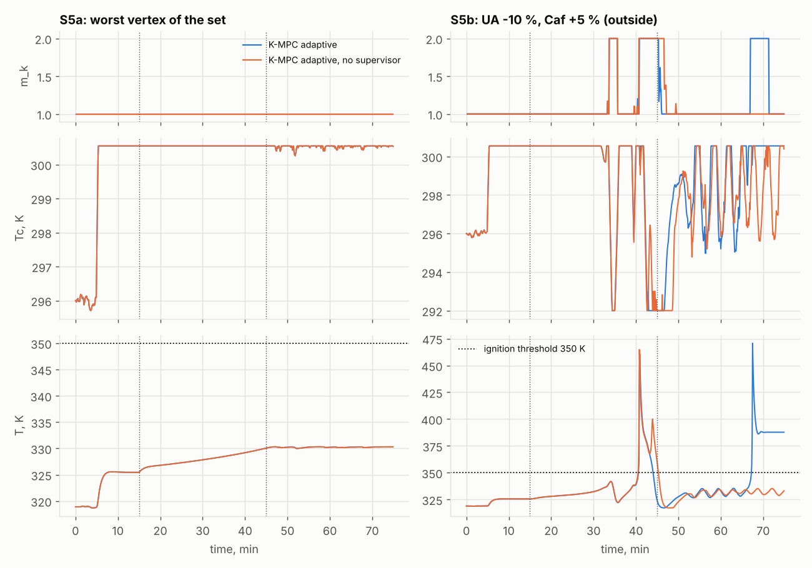

# Part 2: K-MPC in closed loop, validation report

Generated by `report_mpc.py` from `outputs/mpc_seeds.json` (seeds 0-19), `outputs/mpc_metrics.json` (seed 0, with the oracle), `outputs/mpc_tuning.json`, `outputs/mpc_diag_s3.json`, `outputs/mpc_independent.json`, `outputs/mpc_diag_offset.json`, `outputs/mpc_diag_offset_gate.json` and `outputs/mpc_validation.json`. Every number below is computed from these files. Metrics are on the true Ca of the simulator. Spread: median [25th; 75th percentile] over seeds; the worst seed is named. Part 1 (`outputs/report.md`) is unchanged.

## 1. Setting

Plant: the CSTR of part 1 (Henson & Seborg, 1997); input Tc, held over a step of 0.1 min; output Ca measured with noise 0.002 mol/L, 2 % spikes and gaps. T is not measured (decision R3).

| Setting | Value | Source |
|---|---|---|
| Np, Nc | 20, 5 samples | decision R4 |
| Hard input limits | 292 K <= Tc <= 300.547 K, \|dTc\| <= 1 K per step | TZ 4; R2; R5 |
| Weights | q0 = 1/0.01^2, r0 = rho/1^2, rho = 3 | TZ 5.5; tuned on S0 |
| Disturbance filter gain beta | 0.03 | D2; tuned on S0 |
| PID (SIMC PI) | tau_c = 0.45 min, Kc = -121.1 K L/mol, tau_i = 1.269 min | tuned on S0 |
| OSQP | eps_abs = 1e-09, eps_rel = 1e-09, max_iter = 20000, polishing = True, verbose = False | mpc.OSQP_SETTINGS |
| Anchored window | 500 of 1000 rows fixed | D10, a priori |
| Machine | x86_64, Linux-6.18.44-fc-v114-x86_64-with-glibc2.39, Python 3.13.16; 1 BLAS thread per run, 2 runs in parallel | run_mpc_seeds.py |

Provenance: mpc_seeds.json: code fingerprint 73b3e5c8823c3091 (run_mpc.code_fingerprint), commit 4787e18 with modified run files, 1460 runs computed, 0 from a cache; mpc_metrics.json: code fingerprint 73b3e5c8823c3091 (run_mpc.code_fingerprint), commit 4787e18 with modified run files, 75 runs computed, 0 from a cache.

Ignition limit: Tc_max = 300.547 K = lowest saddle-node point over the vertices of the admissible set (UA -5..0 %, Tf -1..+1 K), 301.047 K at the vertex UA -5 %, Tf +1 K, minus the margin 0.5 K. Nominal Ca at Tc_max: 0.8682 mol/L.

## 2. Acceptance checks (TZ 9)

Decided from the result files:

| Check | Result | Pass |
|---|---|---|
| Violations of the hard input constraints, all runs of all controllers | 0 in 1460 runs over 20 seeds; 0 in the runs of outputs/mpc_metrics.json (seed 0, oracle included) | yes |
| Ignition (T > 350 K) in S1, S2, S3, S4, S5a, S6, K-MPC static and K-MPC adaptive, all seeds | K-MPC static: 0 runs; K-MPC adaptive: 0 runs; highest T 330.4 K | yes |
| S2: \|steady-state error\| on the true Ca <= 0.001 mol/L, both K-MPC, every seed | K-MPC static: worst 0.0008 (seed 2); K-MPC adaptive: worst 0.0053 (seed 15) | **no** |
| Fallback plan in at most 0.1 % of the steps of each MPC configuration, all seeds of S1, S2, S3, S4, S5a, S6 together (TZ 14, D11) | highest 9 of 129760 steps (0.007 %, K-MPC adaptive, sign gate) | yes |
| K-MPC step time (identifier + controller, one sample), 95th percentile <= 60 ms, one BLAS thread, S1, S2, S3, S4, S5a, S6 (TZ 14, D15) | highest p95 of a run 62.9 ms (K-MPC adaptive, anchored window, S6, seed 10) | **no** |

Decided by the tests (`python -m unittest discover -s tests`): G against central differences; QP matrices against numerical derivatives; OSQP against SciPy and the closed form; time convention; offset-free control; determinism (seed 0 of run_mpc.py and run_mpc_seeds.py, two separate runs, equal apart from the time fields: `SeedResults`); part 1 files unchanged (P12, `Part1Unchanged`); the numbers of the Part 2 section of README.md (`ReadmeNumbers`). Mutations: `tests/mutate_mpc.py`, log `outputs/mutations_mpc.txt`.

## 3. Results by scenario

**S1: set-point steps across the reachable range.** 20 seeds.

| Configuration | IAE, mol/L min | worst seed | TV of Tc, K | highest T, K | ignitions | supervisor not normal |
|---|---|---|---|---|---|---|
| PID | 0.5059 [0.5017; 0.5088] | 0.5137 (seed 2) | 180.4 [177.6; 184.2] | 325.5 (seed 4) | 0 of 20 | - |
| linear MPC (OE) | 0.5837 [0.5715; 0.5923] | 0.6195 (seed 12) | 280.2 [263.1; 297.8] | 325.5 (seed 2) | 0 of 20 | - |
| K-MPC static | 0.5144 [0.5130; 0.5201] | 0.5495 (seed 18) | 67.5 [67.1; 69.8] | 325.5 (seed 19) | 0 of 20 | - |
| K-MPC adaptive, no supervisor | 0.5246 [0.5201; 0.5427] | 0.6410 (seed 8) | 71.3 [67.7; 74.7] | 325.5 (seed 2) | 0 of 20 | - |
| K-MPC adaptive | 0.5246 [0.5201; 0.5427] | 0.6410 (seed 8) | 71.3 [67.7; 74.7] | 325.5 (seed 2) | 0 of 20 | 0.0 [0.0; 0.0] % |
| K-MPC adaptive, anchored window | 0.5258 [0.5161; 0.5364] | 0.5803 (seed 2) | 70.3 [68.6; 74.3] | 325.5 (seed 2) | 0 of 20 | 0.0 [0.0; 0.0] % |
| K-MPC adaptive, sign gate | 0.5243 [0.5202; 0.5431] | 0.6755 (seed 8) | 71.3 [67.7; 74.7] | 325.5 (seed 2) | 0 of 20 | 0.0 [0.0; 0.0] % |
| K-MPC adaptive, anchored window, sign gate | 0.5258 [0.5161; 0.5365] | 0.5800 (seed 2) | 70.3 [68.6; 74.3] | 325.5 (seed 2) | 0 of 20 | 0.0 [0.0; 0.0] % |
| K-MPC adaptive, excitation window | 0.5173 [0.5148; 0.5255] | 0.6076 (seed 2) | 67.9 [66.6; 70.3] | 325.5 (seed 19) | 0 of 20 | 0.0 [0.0; 0.0] % |
| NMPC on the same KRR | 0.5240 [0.5181; 0.5315] | 0.6220 (seed 8) | 67.6 [66.3; 68.7] | 325.5 (seed 2) | 0 of 20 | 0.0 [0.0; 0.0] % |

Settling into the band +-0.005 mol/L (staying in it to the end of the segment) and overshoot past the new set-point, pooled over the 6 set-point steps of each seed:

| Configuration | settling time, min | steps not settled | overshoot, % of the step |
|---|---|---|---|
| PID | 2.7 [2.3; 2.8] | 0 of 120 | 0.9 [0.3; 1.5] |
| linear MPC (OE) | 3.1 [2.7; 3.6] | 2 of 120 | 0.0 [0.0; 0.6] |
| K-MPC static | 2.7 [2.6; 2.8] | 0 of 120 | 4.9 [3.3; 7.4] |
| K-MPC adaptive, no supervisor | 2.7 [2.6; 3.0] | 0 of 120 | 5.0 [3.8; 6.7] |
| K-MPC adaptive | 2.7 [2.6; 3.0] | 0 of 120 | 5.0 [3.8; 6.7] |
| K-MPC adaptive, anchored window | 2.7 [2.6; 2.8] | 0 of 120 | 4.6 [3.7; 6.4] |
| K-MPC adaptive, sign gate | 2.7 [2.6; 3.0] | 0 of 120 | 5.0 [3.9; 6.7] |
| K-MPC adaptive, anchored window, sign gate | 2.7 [2.6; 2.8] | 0 of 120 | 4.6 [3.8; 6.4] |
| K-MPC adaptive, excitation window | 2.7 [2.6; 2.8] | 0 of 120 | 4.6 [3.3; 6.6] |
| NMPC on the same KRR | 2.7 [2.6; 2.9] | 0 of 120 | 5.0 [3.9; 6.9] |

**S2: Tf steps +1 K and -1 K, UA ramp to -5 %.** 20 seeds.

| Configuration | IAE, mol/L min | worst seed | TV of Tc, K | highest T, K | ignitions | supervisor not normal |
|---|---|---|---|---|---|---|
| PID | 0.0546 [0.0528; 0.0573] | 0.0626 (seed 12) | 257.6 [254.9; 264.4] | 320.9 (seed 8) | 0 of 20 | - |
| linear MPC (OE) | 0.1486 [0.1231; 0.1655] | 0.2027 (seed 17) | 436.0 [412.3; 486.2] | 321.7 (seed 15) | 0 of 20 | - |
| K-MPC static | 0.0677 [0.0643; 0.0710] | 0.0800 (seed 19) | 45.7 [44.4; 46.9] | 320.8 (seed 8) | 0 of 20 | - |
| K-MPC adaptive, no supervisor | 0.0772 [0.0737; 0.0887] | 0.1275 (seed 15) | 37.2 [35.7; 43.4] | 321.0 (seed 16) | 0 of 20 | - |
| K-MPC adaptive | 0.0772 [0.0737; 0.0887] | 0.1275 (seed 15) | 37.2 [35.7; 43.4] | 321.0 (seed 16) | 0 of 20 | 0.0 [0.0; 0.0] % |
| K-MPC adaptive, anchored window | 0.0664 [0.0614; 0.0702] | 0.0805 (seed 5) | 42.1 [40.4; 44.3] | 320.9 (seed 8) | 0 of 20 | 0.0 [0.0; 0.0] % |
| K-MPC adaptive, sign gate | 0.0742 [0.0670; 0.0830] | 0.1208 (seed 16) | 36.8 [35.6; 39.7] | 321.0 (seed 16) | 0 of 20 | 0.0 [0.0; 0.0] % |
| K-MPC adaptive, anchored window, sign gate | 0.0664 [0.0614; 0.0702] | 0.0805 (seed 5) | 42.1 [40.4; 44.3] | 320.9 (seed 8) | 0 of 20 | 0.0 [0.0; 0.0] % |
| K-MPC adaptive, excitation window | 0.0700 [0.0639; 0.0733] | 0.0819 (seed 19) | 47.1 [44.6; 49.7] | 320.8 (seed 8) | 0 of 20 | 0.0 [0.0; 0.0] % |
| NMPC on the same KRR | 0.0769 [0.0737; 0.0888] | 0.1404 (seed 15) | 36.5 [35.3; 39.7] | 321.2 (seed 15) | 0 of 20 | 0.0 [0.0; 0.0] % |

Largest |steady-state error| over the segments with a constant disturbance at their end (mean of the last 5 min), mol/L:

| Configuration | spread | worst seed | seeds <= 0.001 |
|---|---|---|---|
| PID | 0.0005 [0.0003; 0.0005] | 0.0007 (seed 2) | 20 of 20 |
| linear MPC (OE) | 0.0024 [0.0018; 0.0036] | 0.0052 (seed 15) | 0 of 20 |
| K-MPC static | 0.0004 [0.0003; 0.0005] | 0.0008 (seed 2) | 20 of 20 |
| K-MPC adaptive, no supervisor | 0.0009 [0.0006; 0.0023] | 0.0053 (seed 15) | 12 of 20 |
| K-MPC adaptive | 0.0009 [0.0006; 0.0023] | 0.0053 (seed 15) | 12 of 20 |
| K-MPC adaptive, anchored window | 0.0006 [0.0005; 0.0007] | 0.0011 (seed 5) | 19 of 20 |
| K-MPC adaptive, sign gate | 0.0006 [0.0004; 0.0008] | 0.0035 (seed 16) | 17 of 20 |
| K-MPC adaptive, anchored window, sign gate | 0.0006 [0.0005; 0.0007] | 0.0011 (seed 5) | 19 of 20 |
| K-MPC adaptive, excitation window | 0.0004 [0.0003; 0.0005] | 0.0008 (seed 13) | 20 of 20 |
| NMPC on the same KRR | 0.0008 [0.0006; 0.0025] | 0.0068 (seed 15) | 12 of 20 |

Seeds with |steady-state error| > 0.001 mol/L, by segment (segments that end with a constant disturbance):

| Configuration | Tf +1 K | Tf -1 K | Tf back | UA ramp | after the UA ramp |
|---|---|---|---|---|---|
| K-MPC static | 0 | 0 | 0 | - | 0 |
| K-MPC adaptive | 0 | 0 | 0 | - | 8 |
| K-MPC adaptive, anchored window | 0 | 0 | 0 | - | 1 |
| K-MPC adaptive, sign gate | 0 | 0 | 0 | - | 3 |
| K-MPC adaptive, anchored window, sign gate | 0 | 0 | 0 | - | 1 |
| K-MPC adaptive, excitation window | 0 | 0 | 0 | - | 0 |
| NMPC on the same KRR | 0 | 0 | 0 | - | 8 |

**S3: k0 drift to x0.8 over 300 min, set-point changes.** 20 seeds.

| Configuration | IAE, mol/L min | worst seed | TV of Tc, K | highest T, K | ignitions | supervisor not normal |
|---|---|---|---|---|---|---|
| PID | 0.2860 [0.2820; 0.2952] | 0.3218 (seed 7) | 805.9 [792.3; 814.6] | 321.6 (seed 7) | 0 of 20 | - |
| linear MPC (OE) | 0.6492 [0.5748; 0.6996] | 0.7349 (seed 17) | 1320.1 [1270.4; 1472.1] | 322.4 (seed 10) | 0 of 20 | - |
| K-MPC static | 0.2694 [0.2669; 0.2916] | 0.3529 (seed 7) | 172.1 [165.1; 183.1] | 322.0 (seed 2) | 0 of 20 | - |
| K-MPC adaptive, no supervisor | 0.3523 [0.3334; 0.3736] | 0.5376 (seed 12) | 135.6 [129.7; 141.5] | 323.7 (seed 12) | 0 of 20 | - |
| K-MPC adaptive | 0.3523 [0.3334; 0.3734] | 0.5373 (seed 12) | 135.6 [129.7; 141.5] | 323.7 (seed 12) | 0 of 20 | 0.0 [0.0; 0.2] % |
| K-MPC adaptive, anchored window | 0.3093 [0.2944; 0.3256] | 0.3830 (seed 10) | 164.0 [159.7; 172.4] | 322.3 (seed 19) | 0 of 20 | 0.0 [0.0; 0.0] % |
| K-MPC adaptive, sign gate | 0.3558 [0.3396; 0.3865] | 0.5644 (seed 12) | 137.6 [129.3; 144.0] | 323.7 (seed 12) | 0 of 20 | 0.0 [0.0; 0.5] % |
| K-MPC adaptive, anchored window, sign gate | 0.3093 [0.2944; 0.3259] | 0.3847 (seed 10) | 164.0 [160.0; 172.4] | 322.3 (seed 19) | 0 of 20 | 0.0 [0.0; 0.0] % |
| K-MPC adaptive, excitation window | 0.2721 [0.2668; 0.2775] | 0.3190 (seed 7) | 187.5 [179.4; 192.8] | 321.7 (seed 2) | 0 of 20 | 0.0 [0.0; 0.0] % |
| NMPC on the same KRR | 0.3457 [0.3289; 0.3740] | 0.5077 (seed 7) | 132.0 [126.3; 136.7] | 323.6 (seed 12) | 0 of 20 | 0.0 [0.0; 0.2] % |

**S4: measurement faults (spikes, gap, run).** 20 seeds.

| Configuration | IAE, mol/L min | worst seed | TV of Tc, K | highest T, K | ignitions | supervisor not normal |
|---|---|---|---|---|---|---|
| PID | 0.1323 [0.1306; 0.1372] | 0.1397 (seed 14) | 137.1 [133.3; 139.9] | 324.0 (seed 1) | 0 of 20 | - |
| linear MPC (OE) | 0.1784 [0.1648; 0.1946] | 0.2119 (seed 8) | 218.3 [206.2; 249.3] | 323.9 (seed 9) | 0 of 20 | - |
| K-MPC static | 0.1309 [0.1283; 0.1323] | 0.1433 (seed 12) | 36.9 [36.0; 37.8] | 324.5 (seed 6) | 0 of 20 | - |
| K-MPC adaptive, no supervisor | 0.1376 [0.1327; 0.1477] | 0.1604 (seed 7) | 36.6 [35.9; 37.9] | 324.6 (seed 1) | 0 of 20 | - |
| K-MPC adaptive | 0.1376 [0.1327; 0.1477] | 0.1604 (seed 7) | 36.6 [35.9; 37.9] | 324.6 (seed 1) | 0 of 20 | 0.0 [0.0; 0.0] % |
| K-MPC adaptive, anchored window | 0.1365 [0.1336; 0.1416] | 0.1768 (seed 12) | 36.5 [35.6; 37.9] | 324.6 (seed 1) | 0 of 20 | 0.0 [0.0; 0.0] % |
| K-MPC adaptive, sign gate | 0.1406 [0.1327; 0.1499] | 0.1800 (seed 15) | 36.7 [35.9; 37.9] | 324.6 (seed 1) | 0 of 20 | 0.0 [0.0; 0.0] % |
| K-MPC adaptive, anchored window, sign gate | 0.1366 [0.1335; 0.1418] | 0.1768 (seed 12) | 36.5 [35.6; 37.9] | 324.6 (seed 1) | 0 of 20 | 0.0 [0.0; 0.0] % |
| K-MPC adaptive, excitation window | 0.1326 [0.1300; 0.1343] | 0.1468 (seed 12) | 37.0 [35.6; 38.2] | 324.6 (seed 6) | 0 of 20 | 0.0 [0.0; 0.0] % |
| NMPC on the same KRR | 0.1367 [0.1327; 0.1463] | 0.1583 (seed 7) | 36.4 [35.4; 37.8] | 324.6 (seed 1) | 0 of 20 | 0.0 [0.0; 0.0] % |
| K-MPC adaptive, no filter | 0.1689 [0.1627; 0.1865] | 0.2325 (seed 7) | 46.5 [45.4; 48.2] | 324.6 (seed 1) | 0 of 20 | 0.8 [0.0; 1.6] % |
| K-MPC adaptive, reference without spikes | 0.1387 [0.1335; 0.1442] | 0.1624 (seed 7) | 36.4 [35.9; 38.2] | 324.6 (seed 1) | 0 of 20 | 0.0 [0.0; 0.0] % |

Filter in real time, and the input trajectory against the run without spikes (same noise and gap): steps where Tc differs from that run by more than the threshold, and the largest difference. The two trajectories diverge also through rejected samples, which are replaced by the model's prediction and kept out of the window: the difference is not only moves caused by spikes that reached the controller.

| Configuration | normal samples rejected | samples restored | spikes caught | steps with \|Tc - Tc without spikes\| > 0.1 K | largest \|Tc - Tc without spikes\|, K |
|---|---|---|---|---|---|
| PID | 0 [0; 0] | 0 [0; 0] | 100.0 [100.0; 100.0] % | - | - |
| linear MPC (OE) | 0 [0; 0] | 0 [0; 0] | 100.0 [100.0; 100.0] % | - | - |
| K-MPC static | 0 [0; 1] | 0 [0; 0] | 100.0 [100.0; 100.0] % | - | - |
| K-MPC adaptive, no supervisor | 0 [0; 1] | 0 [0; 0] | 100.0 [100.0; 100.0] % | - | - |
| K-MPC adaptive | 0 [0; 1] | 0 [0; 0] | 100.0 [100.0; 100.0] % | 16 [8; 44] | 0.357 [0.161; 0.516] |
| K-MPC adaptive, anchored window | 0 [0; 1] | 0 [0; 0] | 100.0 [100.0; 100.0] % | - | - |
| K-MPC adaptive, sign gate | 0 [0; 1] | 0 [0; 0] | 100.0 [100.0; 100.0] % | - | - |
| K-MPC adaptive, anchored window, sign gate | 0 [0; 1] | 0 [0; 0] | 100.0 [100.0; 100.0] % | - | - |
| K-MPC adaptive, excitation window | 0 [0; 1] | 0 [0; 0] | 100.0 [98.1; 100.0] % | - | - |
| NMPC on the same KRR | 0 [0; 1] | 0 [0; 0] | 100.0 [100.0; 100.0] % | - | - |
| K-MPC adaptive, no filter | 0 [0; 0] | 0 [0; 0] | 0.0 [0.0; 0.0] % | 202 [166; 230] | 1.604 [1.356; 1.800] |
| K-MPC adaptive, reference without spikes | 0 [0; 1] | 0 [0; 0] | - | - | - |

**S5a: worst vertex of the admissible set (UA -5 %, Tf +1 K), set-point at the edge.** 20 seeds.

| Configuration | IAE, mol/L min | worst seed | TV of Tc, K | highest T, K | ignitions | supervisor not normal |
|---|---|---|---|---|---|---|
| PID | 1.5167 [1.5128; 1.5216] | 1.6263 (seed 15) | 33.3 [32.0; 35.7] | 330.4 (seed 15) | 0 of 20 | - |
| linear MPC (OE) | 1.7194 [1.6752; 1.7760] | 1.9769 (seed 15) | 102.3 [88.9; 110.6] | 330.3 (seed 3) | 0 of 20 | - |
| K-MPC static | 1.5177 [1.5108; 1.5467] | 1.9169 (seed 13) | 16.7 [13.4; 19.4] | 330.4 (seed 6) | 0 of 20 | - |
| K-MPC adaptive, no supervisor | 1.5130 [1.5028; 1.5250] | 2.0403 (seed 15) | 12.3 [11.2; 14.3] | 330.4 (seed 2) | 0 of 20 | - |
| K-MPC adaptive | 1.5130 [1.5028; 1.5250] | 2.0405 (seed 15) | 12.3 [11.2; 14.3] | 330.4 (seed 9) | 0 of 20 | 0.0 [0.0; 0.0] % |
| K-MPC adaptive, anchored window | 1.5345 [1.5062; 1.5635] | 1.8783 (seed 6) | 12.9 [11.6; 17.0] | 330.4 (seed 18) | 0 of 20 | 0.0 [0.0; 0.0] % |
| K-MPC adaptive, sign gate | 1.5135 [1.5039; 1.5309] | 2.0812 (seed 15) | 13.0 [10.8; 15.0] | 330.3 (seed 2) | 0 of 20 | 0.0 [0.0; 0.0] % |
| K-MPC adaptive, anchored window, sign gate | 1.5213 [1.5042; 1.5583] | 1.8052 (seed 7) | 12.4 [10.7; 19.1] | 330.5 (seed 7) | 0 of 20 | 0.0 [0.0; 0.0] % |
| K-MPC adaptive, excitation window | 1.5096 [1.5002; 1.5424] | 1.7639 (seed 2) | 14.6 [13.0; 19.3] | 330.5 (seed 2) | 0 of 20 | 0.0 [0.0; 0.0] % |
| NMPC on the same KRR | 1.5122 [1.5028; 1.5249] | 1.8136 (seed 2) | 11.9 [10.7; 13.7] | 330.4 (seed 9) | 0 of 20 | 0.0 [0.0; 0.0] % |
| K-MPC adaptive, symmetric penalty | 1.5130 [1.5028; 1.5250] | 2.0405 (seed 15) | 12.3 [11.2; 14.3] | 330.4 (seed 2) | 0 of 20 | 0.0 [0.0; 0.0] % |

Asymmetric vs symmetric supervisor penalty: the supervisor left its normal regime (m_k > 1) on 2 of 20 seeds (2, 15); elsewhere the two QPs are the same problem. IAE equal within a relative 1e-06 on 19 of 20 seeds; the asymmetric one lower on 1, higher on 0.

**S5b: UA -10 %, Caf +5 % (outside the set).** 20 seeds.

| Configuration | IAE, mol/L min | worst seed | TV of Tc, K | highest T, K | ignitions | supervisor not normal |
|---|---|---|---|---|---|---|
| PID | 9.5362 [9.4685; 9.6442] | 10.9983 (seed 18) | 126.1 [123.8; 127.1] | 487.4 (seed 17) | 20 of 20 | - |
| linear MPC (OE) | 4.8699 [3.9899; 7.1328] | 9.3648 (seed 14) | 190.6 [175.3; 216.2] | 484.0 (seed 2) | 15 of 20 | - |
| K-MPC static | 9.5094 [8.1625; 14.8822] | 31.5895 (seed 7) | 81.2 [61.8; 85.3] | 485.8 (seed 18) | 20 of 20 | - |
| K-MPC adaptive, no supervisor | 13.9976 [10.0737; 19.7517] | 25.1745 (seed 10) | 107.5 [81.1; 146.7] | 488.6 (seed 7) | 20 of 20 | - |
| K-MPC adaptive | 11.1489 [9.1820; 20.2609] | 26.1027 (seed 14) | 122.6 [76.2; 157.7] | 488.4 (seed 13) | 20 of 20 | 16.9 [12.6; 21.8] % |
| K-MPC adaptive, anchored window | 14.6635 [10.3801; 21.9551] | 24.2877 (seed 16) | 101.0 [75.2; 142.0] | 486.0 (seed 14) | 20 of 20 | 17.5 [14.1; 22.3] % |
| K-MPC adaptive, sign gate | 10.5385 [8.4246; 14.3899] | 23.8813 (seed 3) | 128.3 [118.5; 163.4] | 486.9 (seed 14) | 20 of 20 | 20.5 [15.7; 28.3] % |
| K-MPC adaptive, anchored window, sign gate | 12.6274 [8.5123; 18.6029] | 27.1375 (seed 11) | 131.2 [96.7; 160.1] | 488.4 (seed 10) | 20 of 20 | 24.1 [15.1; 31.1] % |
| K-MPC adaptive, excitation window | 8.9258 [7.9954; 9.6473] | 31.7026 (seed 2) | 75.8 [72.9; 85.7] | 487.1 (seed 6) | 20 of 20 | 31.6 [23.8; 34.0] % |
| NMPC on the same KRR | 12.8399 [6.7413; 19.8661] | 25.9267 (seed 19) | 88.1 [68.2; 132.6] | 487.9 (seed 14) | 20 of 20 | 14.0 [11.3; 20.2] % |

**S6: set-point outside the reachable range.** 20 seeds.

| Configuration | IAE, mol/L min | worst seed | TV of Tc, K | highest T, K | ignitions | supervisor not normal |
|---|---|---|---|---|---|---|
| PID | 0.5469 [0.5444; 0.5483] | 0.5520 (seed 4) | 80.4 [76.8; 81.9] | 325.6 (seed 13) | 0 of 20 | - |
| linear MPC (OE) | 0.5805 [0.5724; 0.5910] | 0.6134 (seed 12) | 149.8 [132.5; 173.6] | 325.6 (seed 2) | 0 of 20 | - |
| K-MPC static | 0.5457 [0.5429; 0.5473] | 0.5605 (seed 15) | 37.4 [35.5; 37.8] | 325.6 (seed 3) | 0 of 20 | - |
| K-MPC adaptive, no supervisor | 0.5572 [0.5507; 0.5686] | 0.6517 (seed 4) | 43.8 [37.6; 56.5] | 325.6 (seed 3) | 0 of 20 | - |
| K-MPC adaptive | 0.5572 [0.5507; 0.5686] | 0.6517 (seed 4) | 43.8 [37.6; 56.5] | 325.6 (seed 3) | 0 of 20 | 0.0 [0.0; 0.0] % |
| K-MPC adaptive, anchored window | 0.5535 [0.5473; 0.5635] | 0.6425 (seed 4) | 44.3 [37.8; 58.3] | 325.6 (seed 3) | 0 of 20 | 0.0 [0.0; 0.0] % |
| K-MPC adaptive, sign gate | 0.5559 [0.5495; 0.5676] | 0.6517 (seed 4) | 42.7 [37.6; 47.7] | 325.6 (seed 3) | 0 of 20 | 0.0 [0.0; 0.0] % |
| K-MPC adaptive, anchored window, sign gate | 0.5503 [0.5451; 0.5625] | 0.6425 (seed 4) | 39.6 [36.9; 49.7] | 325.6 (seed 14) | 0 of 20 | 0.0 [0.0; 0.0] % |
| K-MPC adaptive, excitation window | 0.5508 [0.5456; 0.5589] | 0.8792 (seed 2) | 37.9 [34.5; 40.8] | 325.6 (seed 2) | 0 of 20 | 0.0 [0.0; 0.0] % |
| NMPC on the same KRR | 0.5483 [0.5459; 0.5573] | 0.5753 (seed 4) | 36.9 [33.2; 38.7] | 325.6 (seed 13) | 0 of 20 | 0.0 [0.0; 0.0] % |

Time at the input limits and settling after the set-point returns from below the range (Tc at its upper limit), min:

| Configuration | at Tc_max | at Tc_min | settling after return | not settled |
|---|---|---|---|---|
| PID | 26.6 [26.6; 26.6] % | 26.8 [26.6; 26.8] % | 2.1 [2.1; 2.1] | 0 of 20 |
| linear MPC (OE) | 22.4 [21.3; 23.2] % | 19.3 [17.2; 20.5] % | 2.1 [2.1; 2.2] | 0 of 20 |
| K-MPC static | 26.6 [26.6; 26.6] % | 26.5 [26.5; 26.6] % | 1.9 [1.9; 2.0] | 0 of 20 |
| K-MPC adaptive, no supervisor | 26.6 [26.5; 26.6] % | 22.9 [17.0; 26.5] % | 2.0 [2.0; 2.6] | 0 of 20 |
| K-MPC adaptive | 26.6 [26.5; 26.6] % | 22.9 [17.0; 26.5] % | 2.0 [2.0; 2.6] | 0 of 20 |
| K-MPC adaptive, anchored window | 26.6 [26.6; 26.6] % | 21.7 [15.9; 26.6] % | 2.0 [1.9; 2.5] | 0 of 20 |
| K-MPC adaptive, sign gate | 26.6 [26.5; 26.6] % | 25.4 [19.7; 26.5] % | 2.0 [2.0; 2.6] | 0 of 20 |
| K-MPC adaptive, anchored window, sign gate | 26.6 [26.6; 26.6] % | 25.6 [18.4; 26.6] % | 2.0 [1.9; 2.5] | 0 of 20 |
| K-MPC adaptive, excitation window | 26.6 [26.6; 26.6] % | 26.5 [25.4; 26.5] % | 2.1 [2.0; 2.2] | 0 of 20 |
| NMPC on the same KRR | 26.6 [26.6; 26.6] % | 22.7 [21.0; 26.6] % | 2.1 [2.0; 2.5] | 0 of 20 |

"Supervisor not normal": share of steps with the supervisor in the cautious or conservative regime, configurations that use its multiplier.

Rows added to the window by "K-MPC adaptive, excitation window" (D14: only during 50 samples after a set-point change). Where it adds none, its model is the KRR of the start-up record and is not adapted:

| Scenario | rows added | seeds with no row added |
|---|---|---|
| S1 | 295 [294; 296] (range 292 .. 297) | 0 of 20 |
| S2 | 0 [0; 0] (range 0 .. 0) | 20 of 20 |
| S3 | 490 [487; 491] (range 484 .. 493) | 0 of 20 |
| S4 | 137 [136; 138] (range 133 .. 138) | 0 of 20 |
| S5a | 49 [48; 50] (range 47 .. 50) | 0 of 20 |
| S5b | 50 [49; 50] (range 48 .. 50) | 0 of 20 |
| S6 | 196 [195; 197] (range 193 .. 199) | 0 of 20 |

## 4. Pairwise comparisons on the same seeds

Each pair separates one factor (TZ 7). "A lower": seeds on which A has the lower IAE (ties apart); ratio: median of IAE_A / IAE_B over the seeds. The same for the total variation of Tc.

| A vs B | factor | scenario | A lower IAE | equal IAE | IAE ratio | A lower TV | TV ratio |
|---|---|---|---|---|---|---|---|
| K-MPC static vs linear MPC (OE) | nonlinear model (KRR vs OE), both frozen | S1 | 19 of 20 | 0 | 0.878 | 20 of 20 | 0.247 |
| K-MPC static vs linear MPC (OE) | nonlinear model (KRR vs OE), both frozen | S2 | 20 of 20 | 0 | 0.440 | 20 of 20 | 0.101 |
| K-MPC static vs linear MPC (OE) | nonlinear model (KRR vs OE), both frozen | S3 | 20 of 20 | 0 | 0.430 | 20 of 20 | 0.133 |
| K-MPC static vs linear MPC (OE) | nonlinear model (KRR vs OE), both frozen | S4 | 20 of 20 | 0 | 0.722 | 20 of 20 | 0.167 |
| K-MPC static vs linear MPC (OE) | nonlinear model (KRR vs OE), both frozen | S5a | 18 of 20 | 0 | 0.891 | 20 of 20 | 0.189 |
| K-MPC static vs linear MPC (OE) | nonlinear model (KRR vs OE), both frozen | S5b | 1 of 20 | 0 | 2.034 | 20 of 20 | 0.380 |
| K-MPC static vs linear MPC (OE) | nonlinear model (KRR vs OE), both frozen | S6 | 20 of 20 | 0 | 0.943 | 20 of 20 | 0.249 |
| K-MPC adaptive vs K-MPC static | adaptation of the model | S1 | 4 of 20 | 0 | 1.020 | 6 of 20 | 1.040 |
| K-MPC adaptive vs K-MPC static | adaptation of the model | S2 | 2 of 20 | 0 | 1.163 | 19 of 20 | 0.834 |
| K-MPC adaptive vs K-MPC static | adaptation of the model | S3 | 0 of 20 | 0 | 1.247 | 20 of 20 | 0.781 |
| K-MPC adaptive vs K-MPC static | adaptation of the model | S4 | 0 of 20 | 0 | 1.041 | 11 of 20 | 0.996 |
| K-MPC adaptive vs K-MPC static | adaptation of the model | S5a | 12 of 20 | 0 | 0.995 | 14 of 20 | 0.810 |
| K-MPC adaptive vs K-MPC static | adaptation of the model | S5b | 9 of 20 | 0 | 1.082 | 4 of 20 | 1.794 |
| K-MPC adaptive vs K-MPC static | adaptation of the model | S6 | 3 of 20 | 0 | 1.023 | 3 of 20 | 1.238 |
| K-MPC adaptive vs NMPC on the same KRR | linearisation (QP vs SLSQP; each run has its own identifier, so the windows differ after the first different input; same states: section Independent calculations) | S1 | 3 of 20 | 0 | 1.005 | 5 of 20 | 1.015 |
| K-MPC adaptive vs NMPC on the same KRR | linearisation (QP vs SLSQP; each run has its own identifier, so the windows differ after the first different input; same states: section Independent calculations) | S2 | 8 of 20 | 0 | 1.000 | 5 of 20 | 1.001 |
| K-MPC adaptive vs NMPC on the same KRR | linearisation (QP vs SLSQP; each run has its own identifier, so the windows differ after the first different input; same states: section Independent calculations) | S3 | 3 of 20 | 0 | 1.007 | 1 of 20 | 1.022 |
| K-MPC adaptive vs NMPC on the same KRR | linearisation (QP vs SLSQP; each run has its own identifier, so the windows differ after the first different input; same states: section Independent calculations) | S4 | 3 of 20 | 0 | 1.001 | 1 of 20 | 1.002 |
| K-MPC adaptive vs NMPC on the same KRR | linearisation (QP vs SLSQP; each run has its own identifier, so the windows differ after the first different input; same states: section Independent calculations) | S5a | 10 of 20 | 0 | 1.000 | 5 of 20 | 1.001 |
| K-MPC adaptive vs NMPC on the same KRR | linearisation (QP vs SLSQP; each run has its own identifier, so the windows differ after the first different input; same states: section Independent calculations) | S5b | 6 of 20 | 0 | 1.138 | 8 of 20 | 1.138 |
| K-MPC adaptive vs NMPC on the same KRR | linearisation (QP vs SLSQP; each run has its own identifier, so the windows differ after the first different input; same states: section Independent calculations) | S6 | 0 of 20 | 0 | 1.015 | 1 of 20 | 1.248 |
| K-MPC adaptive vs K-MPC adaptive, no supervisor | supervisor | S1 | 0 of 20 | 19 | 1.000 | 1 of 20 | 1.000 |
| K-MPC adaptive vs K-MPC adaptive, no supervisor | supervisor | S2 | 0 of 20 | 20 | 1.000 | 0 of 20 | 1.000 |
| K-MPC adaptive vs K-MPC adaptive, no supervisor | supervisor | S3 | 5 of 20 | 15 | 1.000 | 5 of 20 | 1.000 |
| K-MPC adaptive vs K-MPC adaptive, no supervisor | supervisor | S4 | 0 of 20 | 20 | 1.000 | 0 of 20 | 1.000 |
| K-MPC adaptive vs K-MPC adaptive, no supervisor | supervisor | S5a | 0 of 20 | 18 | 1.000 | 1 of 20 | 1.000 |
| K-MPC adaptive vs K-MPC adaptive, no supervisor | supervisor | S5b | 11 of 20 | 0 | 0.997 | 10 of 20 | 0.981 |
| K-MPC adaptive vs K-MPC adaptive, no supervisor | supervisor | S6 | 1 of 20 | 19 | 1.000 | 1 of 20 | 1.000 |
| K-MPC adaptive, anchored window vs K-MPC adaptive | anchored window (D10) | S1 | 13 of 20 | 0 | 0.995 | 12 of 20 | 0.979 |
| K-MPC adaptive, anchored window vs K-MPC adaptive | anchored window (D10) | S2 | 20 of 20 | 0 | 0.832 | 3 of 20 | 1.085 |
| K-MPC adaptive, anchored window vs K-MPC adaptive | anchored window (D10) | S3 | 18 of 20 | 0 | 0.876 | 0 of 20 | 1.231 |
| K-MPC adaptive, anchored window vs K-MPC adaptive | anchored window (D10) | S4 | 8 of 20 | 0 | 1.006 | 11 of 20 | 0.991 |
| K-MPC adaptive, anchored window vs K-MPC adaptive | anchored window (D10) | S5a | 6 of 20 | 0 | 1.006 | 11 of 20 | 0.958 |
| K-MPC adaptive, anchored window vs K-MPC adaptive | anchored window (D10) | S5b | 8 of 20 | 0 | 1.108 | 14 of 20 | 0.873 |
| K-MPC adaptive, anchored window vs K-MPC adaptive | anchored window (D10) | S6 | 14 of 20 | 0 | 0.996 | 10 of 20 | 0.994 |
| K-MPC adaptive, sign gate vs K-MPC adaptive | sign gate (D13) | S1 | 2 of 20 | 11 | 1.000 | 4 of 20 | 1.000 |
| K-MPC adaptive, sign gate vs K-MPC adaptive | sign gate (D13) | S2 | 9 of 20 | 8 | 1.000 | 7 of 20 | 1.000 |
| K-MPC adaptive, sign gate vs K-MPC adaptive | sign gate (D13) | S3 | 7 of 20 | 5 | 1.000 | 6 of 20 | 1.000 |
| K-MPC adaptive, sign gate vs K-MPC adaptive | sign gate (D13) | S4 | 1 of 20 | 15 | 1.000 | 2 of 20 | 1.000 |
| K-MPC adaptive, sign gate vs K-MPC adaptive | sign gate (D13) | S5a | 5 of 20 | 7 | 1.000 | 6 of 20 | 1.000 |
| K-MPC adaptive, sign gate vs K-MPC adaptive | sign gate (D13) | S5b | 12 of 20 | 0 | 0.839 | 8 of 20 | 1.154 |
| K-MPC adaptive, sign gate vs K-MPC adaptive | sign gate (D13) | S6 | 5 of 20 | 12 | 1.000 | 5 of 20 | 1.000 |
| K-MPC adaptive, anchored window, sign gate vs K-MPC adaptive, anchored window | sign gate on the anchored window | S1 | 4 of 20 | 12 | 1.000 | 2 of 20 | 1.000 |
| K-MPC adaptive, anchored window, sign gate vs K-MPC adaptive, anchored window | sign gate on the anchored window | S2 | 0 of 20 | 20 | 1.000 | 0 of 20 | 1.000 |
| K-MPC adaptive, anchored window, sign gate vs K-MPC adaptive, anchored window | sign gate on the anchored window | S3 | 2 of 20 | 13 | 1.000 | 1 of 20 | 1.000 |
| K-MPC adaptive, anchored window, sign gate vs K-MPC adaptive, anchored window | sign gate on the anchored window | S4 | 1 of 20 | 16 | 1.000 | 1 of 20 | 1.000 |
| K-MPC adaptive, anchored window, sign gate vs K-MPC adaptive, anchored window | sign gate on the anchored window | S5a | 7 of 20 | 7 | 1.000 | 6 of 20 | 1.000 |
| K-MPC adaptive, anchored window, sign gate vs K-MPC adaptive, anchored window | sign gate on the anchored window | S5b | 11 of 20 | 0 | 0.921 | 8 of 20 | 1.129 |
| K-MPC adaptive, anchored window, sign gate vs K-MPC adaptive, anchored window | sign gate on the anchored window | S6 | 7 of 20 | 10 | 1.000 | 8 of 20 | 1.000 |
| K-MPC adaptive, excitation window vs K-MPC adaptive | excitation window (D14) | S1 | 15 of 20 | 0 | 0.986 | 16 of 20 | 0.952 |
| K-MPC adaptive, excitation window vs K-MPC adaptive | excitation window (D14) | S2 | 19 of 20 | 0 | 0.870 | 1 of 20 | 1.225 |
| K-MPC adaptive, excitation window vs K-MPC adaptive | excitation window (D14) | S3 | 20 of 20 | 0 | 0.770 | 0 of 20 | 1.385 |
| K-MPC adaptive, excitation window vs K-MPC adaptive | excitation window (D14) | S4 | 16 of 20 | 0 | 0.967 | 11 of 20 | 0.994 |
| K-MPC adaptive, excitation window vs K-MPC adaptive | excitation window (D14) | S5a | 13 of 20 | 0 | 0.995 | 7 of 20 | 1.062 |
| K-MPC adaptive, excitation window vs K-MPC adaptive | excitation window (D14) | S5b | 13 of 20 | 0 | 0.848 | 14 of 20 | 0.657 |
| K-MPC adaptive, excitation window vs K-MPC adaptive | excitation window (D14) | S6 | 16 of 20 | 0 | 0.984 | 14 of 20 | 0.806 |
| K-MPC adaptive, excitation window vs K-MPC static | excitation window against a frozen model | S1 | 5 of 20 | 0 | 1.009 | 12 of 20 | 0.994 |
| K-MPC adaptive, excitation window vs K-MPC static | excitation window against a frozen model | S2 | 6 of 20 | 0 | 1.014 | 6 of 20 | 1.024 |
| K-MPC adaptive, excitation window vs K-MPC static | excitation window against a frozen model | S3 | 13 of 20 | 0 | 0.988 | 3 of 20 | 1.076 |
| K-MPC adaptive, excitation window vs K-MPC static | excitation window against a frozen model | S4 | 4 of 20 | 0 | 1.010 | 11 of 20 | 0.997 |
| K-MPC adaptive, excitation window vs K-MPC static | excitation window against a frozen model | S5a | 15 of 20 | 0 | 0.994 | 15 of 20 | 0.889 |
| K-MPC adaptive, excitation window vs K-MPC static | excitation window against a frozen model | S5b | 15 of 20 | 0 | 0.967 | 12 of 20 | 0.967 |
| K-MPC adaptive, excitation window vs K-MPC static | excitation window against a frozen model | S6 | 3 of 20 | 0 | 1.008 | 8 of 20 | 1.020 |
| K-MPC adaptive vs PID | industrial baseline | S1 | 1 of 20 | 0 | 1.043 | 20 of 20 | 0.391 |
| K-MPC adaptive vs PID | industrial baseline | S2 | 0 of 20 | 0 | 1.407 | 20 of 20 | 0.143 |
| K-MPC adaptive vs PID | industrial baseline | S3 | 0 of 20 | 0 | 1.219 | 20 of 20 | 0.171 |
| K-MPC adaptive vs PID | industrial baseline | S4 | 7 of 20 | 0 | 1.046 | 20 of 20 | 0.267 |
| K-MPC adaptive vs PID | industrial baseline | S5a | 11 of 20 | 0 | 0.996 | 18 of 20 | 0.364 |
| K-MPC adaptive vs PID | industrial baseline | S5b | 6 of 20 | 0 | 1.148 | 11 of 20 | 0.968 |
| K-MPC adaptive vs PID | industrial baseline | S6 | 5 of 20 | 0 | 1.022 | 17 of 20 | 0.565 |

## 5. Fallback plan

Counted as decided in TZ 14, D11: each MPC configuration separately, all seeds of S1, S2, S3, S4, S5a, S6 together; limit 0.1 %. S5b (outside the set) is listed below without a limit.

| Configuration | fallback steps | steps | share |
|---|---|---|---|
| linear MPC (OE) | 5 | 129760 | 0.004 % |
| K-MPC static | 2 | 129760 | 0.002 % |
| K-MPC adaptive, no supervisor | 4 | 129760 | 0.003 % |
| K-MPC adaptive | 5 | 129760 | 0.004 % |
| K-MPC adaptive, anchored window | 2 | 129760 | 0.002 % |
| K-MPC adaptive, sign gate | 9 | 129760 | 0.007 % |
| K-MPC adaptive, anchored window, sign gate | 2 | 129760 | 0.002 % |
| K-MPC adaptive, excitation window | 1 | 129760 | 0.001 % |
| NMPC on the same KRR | 9 | 129760 | 0.007 % |
| K-MPC adaptive, symmetric penalty | 0 | 14960 | 0.000 % |
| K-MPC adaptive, no filter | 0 | 9960 | 0.000 % |
| K-MPC adaptive, reference without spikes | 0 | 9960 | 0.000 % |

Every run with a fallback step (statuses other than 'solved'):

| Scenario | Configuration | seed | fallback steps | steps | statuses |
|---|---|---|---|---|---|
| S1 | K-MPC static | 1 | 1 | 648 | maximum iterations reached: 1 |
| S1 | K-MPC static | 4 | 1 | 648 | maximum iterations reached: 1 |
| S1 | K-MPC adaptive, no supervisor | 5 | 1 | 648 | solved inaccurate: 1 |
| S1 | K-MPC adaptive, no supervisor | 8 | 1 | 648 | maximum iterations reached: 1 |
| S1 | K-MPC adaptive | 5 | 1 | 648 | solved inaccurate: 1 |
| S1 | K-MPC adaptive | 8 | 1 | 648 | maximum iterations reached: 1 |
| S1 | K-MPC adaptive, sign gate | 5 | 1 | 648 | solved inaccurate: 1 |
| S1 | K-MPC adaptive, sign gate | 8 | 4 | 648 | maximum iterations reached: 2; solved inaccurate: 2 |
| S1 | K-MPC adaptive, excitation window | 4 | 1 | 648 | maximum iterations reached: 1 |
| S1 | NMPC on the same KRR | 14 | 1 | 648 | slsqp: Positive directional derivative for linesearch: 1 |
| S2 | linear MPC (OE) | 3 | 1 | 998 | maximum iterations reached: 1 |
| S2 | linear MPC (OE) | 10 | 1 | 998 | maximum iterations reached: 1 |
| S3 | linear MPC (OE) | 6 | 2 | 3048 | maximum iterations reached: 2 |
| S5a | linear MPC (OE) | 6 | 1 | 748 | maximum iterations reached: 1 |
| S5a | K-MPC adaptive, no supervisor | 7 | 1 | 748 | maximum iterations reached: 1 |
| S5a | K-MPC adaptive, no supervisor | 16 | 1 | 748 | solved inaccurate: 1 |
| S5a | K-MPC adaptive | 2 | 1 | 748 | maximum iterations reached: 1 |
| S5a | K-MPC adaptive | 7 | 1 | 748 | maximum iterations reached: 1 |
| S5a | K-MPC adaptive | 16 | 1 | 748 | solved inaccurate: 1 |
| S5a | K-MPC adaptive, anchored window | 5 | 1 | 748 | maximum iterations reached: 1 |
| S5a | K-MPC adaptive, anchored window | 7 | 1 | 748 | maximum iterations reached: 1 |
| S5a | K-MPC adaptive, sign gate | 7 | 3 | 748 | maximum iterations reached: 2; solved inaccurate: 1 |
| S5a | K-MPC adaptive, sign gate | 16 | 1 | 748 | solved inaccurate: 1 |
| S5a | K-MPC adaptive, anchored window, sign gate | 5 | 1 | 748 | maximum iterations reached: 1 |
| S5a | K-MPC adaptive, anchored window, sign gate | 15 | 1 | 748 | maximum iterations reached: 1 |
| S5a | NMPC on the same KRR | 1 | 1 | 748 | slsqp: Positive directional derivative for linesearch: 1 |
| S5a | NMPC on the same KRR | 7 | 1 | 748 | slsqp: Positive directional derivative for linesearch: 1 |
| S5a | NMPC on the same KRR | 9 | 1 | 748 | slsqp: Positive directional derivative for linesearch: 1 |
| S5a | NMPC on the same KRR | 10 | 2 | 748 | slsqp: Positive directional derivative for linesearch: 2 |
| S5a | NMPC on the same KRR | 11 | 1 | 748 | slsqp: Positive directional derivative for linesearch: 1 |
| S5a | NMPC on the same KRR | 17 | 2 | 748 | slsqp: Positive directional derivative for linesearch: 2 |
| S5b | K-MPC static | 19 | 1 | 748 | solved inaccurate: 1 |
| S5b | K-MPC adaptive, no supervisor | 0 | 1 | 748 | maximum iterations reached: 1 |
| S5b | K-MPC adaptive, no supervisor | 9 | 3 | 748 | maximum iterations reached: 2; solved inaccurate: 1 |
| S5b | K-MPC adaptive, no supervisor | 10 | 2 | 748 | maximum iterations reached: 1; solved inaccurate: 1 |
| S5b | K-MPC adaptive, no supervisor | 14 | 3 | 748 | maximum iterations reached: 2; solved inaccurate: 1 |
| S5b | K-MPC adaptive, no supervisor | 15 | 1 | 748 | maximum iterations reached: 1 |
| S5b | K-MPC adaptive, no supervisor | 16 | 1 | 748 | solved inaccurate: 1 |
| S5b | K-MPC adaptive, no supervisor | 18 | 1 | 748 | solved inaccurate: 1 |
| S5b | K-MPC adaptive, no supervisor | 19 | 7 | 748 | maximum iterations reached: 4; solved inaccurate: 3 |
| S5b | K-MPC adaptive | 1 | 1 | 748 | solved inaccurate: 1 |
| S5b | K-MPC adaptive | 4 | 1 | 748 | maximum iterations reached: 1 |
| S5b | K-MPC adaptive | 6 | 1 | 748 | maximum iterations reached: 1 |
| S5b | K-MPC adaptive | 7 | 1 | 748 | solved inaccurate: 1 |
| S5b | K-MPC adaptive | 8 | 2 | 748 | maximum iterations reached: 1; solved inaccurate: 1 |
| S5b | K-MPC adaptive | 9 | 1 | 748 | solved inaccurate: 1 |
| S5b | K-MPC adaptive | 11 | 1 | 748 | maximum iterations reached: 1 |
| S5b | K-MPC adaptive | 12 | 4 | 748 | solved inaccurate: 4 |
| S5b | K-MPC adaptive | 14 | 1 | 748 | solved inaccurate: 1 |
| S5b | K-MPC adaptive | 15 | 2 | 748 | solved inaccurate: 2 |
| S5b | K-MPC adaptive | 16 | 3 | 748 | maximum iterations reached: 2; solved inaccurate: 1 |
| S5b | K-MPC adaptive | 18 | 2 | 748 | solved inaccurate: 2 |
| S5b | K-MPC adaptive | 19 | 5 | 748 | maximum iterations reached: 1; solved inaccurate: 4 |
| S5b | K-MPC adaptive, anchored window | 4 | 1 | 748 | solved inaccurate: 1 |
| S5b | K-MPC adaptive, anchored window | 6 | 1 | 748 | solved inaccurate: 1 |
| S5b | K-MPC adaptive, anchored window | 7 | 3 | 748 | maximum iterations reached: 1; solved inaccurate: 2 |
| S5b | K-MPC adaptive, anchored window | 9 | 1 | 748 | maximum iterations reached: 1 |
| S5b | K-MPC adaptive, anchored window | 12 | 1 | 748 | maximum iterations reached: 1 |
| S5b | K-MPC adaptive, anchored window | 13 | 1 | 748 | solved inaccurate: 1 |
| S5b | K-MPC adaptive, anchored window | 14 | 5 | 748 | maximum iterations reached: 4; solved inaccurate: 1 |
| S5b | K-MPC adaptive, anchored window | 15 | 1 | 748 | solved inaccurate: 1 |
| S5b | K-MPC adaptive, anchored window | 16 | 1 | 748 | solved inaccurate: 1 |
| S5b | K-MPC adaptive, anchored window | 19 | 17 | 748 | maximum iterations reached: 13; solved inaccurate: 4 |
| S5b | K-MPC adaptive, sign gate | 0 | 6 | 748 | maximum iterations reached: 1; solved inaccurate: 5 |
| S5b | K-MPC adaptive, sign gate | 1 | 21 | 748 | maximum iterations reached: 16; solved inaccurate: 5 |
| S5b | K-MPC adaptive, sign gate | 2 | 12 | 748 | maximum iterations reached: 4; solved inaccurate: 8 |
| S5b | K-MPC adaptive, sign gate | 3 | 10 | 748 | solved inaccurate: 10 |
| S5b | K-MPC adaptive, sign gate | 4 | 3 | 748 | maximum iterations reached: 2; solved inaccurate: 1 |
| S5b | K-MPC adaptive, sign gate | 5 | 6 | 748 | maximum iterations reached: 2; solved inaccurate: 4 |
| S5b | K-MPC adaptive, sign gate | 6 | 4 | 748 | solved inaccurate: 4 |
| S5b | K-MPC adaptive, sign gate | 7 | 5 | 748 | maximum iterations reached: 2; solved inaccurate: 3 |
| S5b | K-MPC adaptive, sign gate | 8 | 13 | 748 | maximum iterations reached: 6; solved inaccurate: 7 |
| S5b | K-MPC adaptive, sign gate | 9 | 10 | 748 | maximum iterations reached: 6; solved inaccurate: 4 |
| S5b | K-MPC adaptive, sign gate | 10 | 3 | 748 | maximum iterations reached: 1; solved inaccurate: 2 |
| S5b | K-MPC adaptive, sign gate | 11 | 1 | 748 | maximum iterations reached: 1 |
| S5b | K-MPC adaptive, sign gate | 12 | 13 | 748 | maximum iterations reached: 11; solved inaccurate: 2 |
| S5b | K-MPC adaptive, sign gate | 13 | 10 | 748 | maximum iterations reached: 7; solved inaccurate: 3 |
| S5b | K-MPC adaptive, sign gate | 14 | 10 | 748 | maximum iterations reached: 3; solved inaccurate: 7 |
| S5b | K-MPC adaptive, sign gate | 15 | 3 | 748 | maximum iterations reached: 2; solved inaccurate: 1 |
| S5b | K-MPC adaptive, sign gate | 16 | 1 | 748 | solved inaccurate: 1 |
| S5b | K-MPC adaptive, sign gate | 17 | 4 | 748 | maximum iterations reached: 2; solved inaccurate: 2 |
| S5b | K-MPC adaptive, sign gate | 18 | 7 | 748 | maximum iterations reached: 1; solved inaccurate: 6 |
| S5b | K-MPC adaptive, anchored window, sign gate | 0 | 14 | 748 | maximum iterations reached: 9; solved inaccurate: 5 |
| S5b | K-MPC adaptive, anchored window, sign gate | 1 | 5 | 748 | maximum iterations reached: 2; solved inaccurate: 3 |
| S5b | K-MPC adaptive, anchored window, sign gate | 2 | 10 | 748 | solved inaccurate: 10 |
| S5b | K-MPC adaptive, anchored window, sign gate | 3 | 10 | 748 | maximum iterations reached: 7; solved inaccurate: 3 |
| S5b | K-MPC adaptive, anchored window, sign gate | 5 | 9 | 748 | maximum iterations reached: 3; solved inaccurate: 6 |
| S5b | K-MPC adaptive, anchored window, sign gate | 6 | 3 | 748 | maximum iterations reached: 3 |
| S5b | K-MPC adaptive, anchored window, sign gate | 7 | 7 | 748 | maximum iterations reached: 3; solved inaccurate: 4 |
| S5b | K-MPC adaptive, anchored window, sign gate | 8 | 6 | 748 | maximum iterations reached: 4; solved inaccurate: 2 |
| S5b | K-MPC adaptive, anchored window, sign gate | 9 | 1 | 748 | maximum iterations reached: 1 |
| S5b | K-MPC adaptive, anchored window, sign gate | 10 | 6 | 748 | maximum iterations reached: 4; solved inaccurate: 2 |
| S5b | K-MPC adaptive, anchored window, sign gate | 11 | 16 | 748 | maximum iterations reached: 1; solved inaccurate: 15 |
| S5b | K-MPC adaptive, anchored window, sign gate | 12 | 8 | 748 | maximum iterations reached: 7; solved inaccurate: 1 |
| S5b | K-MPC adaptive, anchored window, sign gate | 13 | 2 | 748 | maximum iterations reached: 1; solved inaccurate: 1 |
| S5b | K-MPC adaptive, anchored window, sign gate | 14 | 19 | 748 | maximum iterations reached: 8; solved inaccurate: 11 |
| S5b | K-MPC adaptive, anchored window, sign gate | 15 | 1 | 748 | maximum iterations reached: 1 |
| S5b | K-MPC adaptive, anchored window, sign gate | 16 | 4 | 748 | maximum iterations reached: 3; solved inaccurate: 1 |
| S5b | K-MPC adaptive, anchored window, sign gate | 18 | 2 | 748 | maximum iterations reached: 2 |
| S5b | K-MPC adaptive, anchored window, sign gate | 19 | 4 | 748 | maximum iterations reached: 2; solved inaccurate: 2 |
| S5b | K-MPC adaptive, excitation window | 0 | 17 | 748 | solved inaccurate: 17 |
| S5b | K-MPC adaptive, excitation window | 1 | 12 | 748 | solved inaccurate: 12 |
| S5b | K-MPC adaptive, excitation window | 3 | 1 | 748 | solved inaccurate: 1 |
| S5b | K-MPC adaptive, excitation window | 5 | 11 | 748 | solved inaccurate: 11 |
| S5b | K-MPC adaptive, excitation window | 6 | 1 | 748 | solved inaccurate: 1 |
| S5b | K-MPC adaptive, excitation window | 10 | 16 | 748 | solved inaccurate: 16 |
| S5b | K-MPC adaptive, excitation window | 11 | 12 | 748 | solved inaccurate: 12 |
| S5b | K-MPC adaptive, excitation window | 14 | 24 | 748 | solved inaccurate: 24 |
| S5b | K-MPC adaptive, excitation window | 15 | 2 | 748 | solved inaccurate: 2 |
| S5b | K-MPC adaptive, excitation window | 17 | 3 | 748 | solved inaccurate: 3 |
| S5b | K-MPC adaptive, excitation window | 18 | 2 | 748 | solved inaccurate: 2 |
| S5b | K-MPC adaptive, excitation window | 19 | 2 | 748 | maximum iterations reached: 1; solved inaccurate: 1 |
| S5b | NMPC on the same KRR | 0 | 16 | 748 | slsqp: Positive directional derivative for linesearch: 16 |
| S5b | NMPC on the same KRR | 1 | 15 | 748 | slsqp: Positive directional derivative for linesearch: 15 |
| S5b | NMPC on the same KRR | 2 | 29 | 748 | slsqp: Positive directional derivative for linesearch: 29 |
| S5b | NMPC on the same KRR | 3 | 24 | 748 | slsqp: Positive directional derivative for linesearch: 24 |
| S5b | NMPC on the same KRR | 4 | 22 | 748 | slsqp: Positive directional derivative for linesearch: 21; slsqp: Inequality constraints incompatible: 1 |
| S5b | NMPC on the same KRR | 5 | 12 | 748 | slsqp: Positive directional derivative for linesearch: 12 |
| S5b | NMPC on the same KRR | 6 | 27 | 748 | slsqp: Positive directional derivative for linesearch: 27 |
| S5b | NMPC on the same KRR | 7 | 54 | 748 | slsqp: Positive directional derivative for linesearch: 54 |
| S5b | NMPC on the same KRR | 8 | 17 | 748 | slsqp: Positive directional derivative for linesearch: 17 |
| S5b | NMPC on the same KRR | 9 | 42 | 748 | slsqp: Positive directional derivative for linesearch: 42 |
| S5b | NMPC on the same KRR | 10 | 15 | 748 | slsqp: Positive directional derivative for linesearch: 15 |
| S5b | NMPC on the same KRR | 11 | 36 | 748 | slsqp: Positive directional derivative for linesearch: 36 |
| S5b | NMPC on the same KRR | 12 | 59 | 748 | slsqp: Positive directional derivative for linesearch: 59 |
| S5b | NMPC on the same KRR | 13 | 83 | 748 | slsqp: Positive directional derivative for linesearch: 81; slsqp: Iteration limit reached: 1; slsqp: Inequality constraints incompatible: 1 |
| S5b | NMPC on the same KRR | 14 | 49 | 748 | slsqp: Positive directional derivative for linesearch: 39; slsqp: Iteration limit reached: 3; slsqp: Inequality constraints incompatible: 7 |
| S5b | NMPC on the same KRR | 15 | 17 | 748 | slsqp: Positive directional derivative for linesearch: 17 |
| S5b | NMPC on the same KRR | 16 | 24 | 748 | slsqp: Positive directional derivative for linesearch: 24 |
| S5b | NMPC on the same KRR | 17 | 9 | 748 | slsqp: Positive directional derivative for linesearch: 9 |
| S5b | NMPC on the same KRR | 18 | 25 | 748 | slsqp: Positive directional derivative for linesearch: 25 |
| S5b | NMPC on the same KRR | 19 | 9 | 748 | slsqp: Positive directional derivative for linesearch: 9 |

## 6. Step time

One BLAS thread per run, 2 runs in parallel on the machine named above. The step of the controller (TZ 4, D15) is the whole sample: identifier (filter, window, refit, GP variance along the plan) plus controller (linearisation, QP or SLSQP). Over the runs of a configuration: median of the run medians, median and highest of the run 95th percentiles, highest single sample.

Whole sample, inside the set (S1, S2, S3, S4, S5a, S6; the acceptance check):

| Configuration | runs | median, ms | p95 median, ms | p95 highest, ms | where | max, ms |
|---|---|---|---|---|---|---|
| PID | 120 | 7.1 | 9.0 | 12.1 | S6, seed 6 | 446.2 |
| linear MPC (OE) | 120 | 8.5 | 11.3 | 14.0 | S6, seed 19 | 135.6 |
| K-MPC static | 120 | 16.1 | 20.8 | 24.3 | S5a, seed 7 | 137.6 |
| K-MPC adaptive, no supervisor | 120 | 10.8 | 21.6 | 46.9 | S5a, seed 1 | 145.0 |
| K-MPC adaptive | 120 | 10.9 | 22.5 | 46.8 | S3, seed 10 | 463.2 |
| K-MPC adaptive, anchored window | 120 | 10.8 | 19.5 | 62.9 | S6, seed 10 | 209.5 |
| K-MPC adaptive, sign gate | 120 | 10.9 | 19.5 | 43.5 | S4, seed 11 | 139.9 |
| K-MPC adaptive, anchored window, sign gate | 120 | 10.9 | 19.4 | 39.6 | S4, seed 11 | 179.6 |
| K-MPC adaptive, excitation window | 120 | 10.8 | 14.5 | 19.7 | S6, seed 5 | 140.9 |
| NMPC on the same KRR | 120 | 39.1 | 69.6 | 102.7 | S2, seed 19 | 449.3 |
| K-MPC adaptive, symmetric penalty | 20 | 10.6 | 18.3 | 32.9 | S5a, seed 1 | 143.1 |
| K-MPC adaptive, no filter | 20 | 10.3 | 16.7 | 26.4 | S4, seed 11 | 54.9 |
| K-MPC adaptive, reference without spikes | 20 | 10.6 | 17.1 | 25.2 | S4, seed 18 | 119.4 |

Whole sample, S5b (outside the set, no limit):

| Configuration | runs | median, ms | p95 median, ms | p95 highest, ms | where | max, ms |
|---|---|---|---|---|---|---|
| PID | 20 | 7.1 | 9.0 | 9.6 | S5b, seed 2 | 25.9 |
| linear MPC (OE) | 20 | 8.6 | 11.6 | 15.9 | S5b, seed 16 | 75.6 |
| K-MPC static | 20 | 16.2 | 20.9 | 30.0 | S5b, seed 16 | 134.8 |
| K-MPC adaptive, no supervisor | 20 | 11.0 | 83.9 | 103.5 | S5b, seed 8 | 157.0 |
| K-MPC adaptive | 20 | 11.1 | 83.4 | 104.0 | S5b, seed 7 | 181.0 |
| K-MPC adaptive, anchored window | 20 | 11.0 | 82.9 | 100.8 | S5b, seed 8 | 170.0 |
| K-MPC adaptive, sign gate | 20 | 11.1 | 86.1 | 102.2 | S5b, seed 4 | 182.9 |
| K-MPC adaptive, anchored window, sign gate | 20 | 11.1 | 83.4 | 98.4 | S5b, seed 8 | 168.9 |
| K-MPC adaptive, excitation window | 20 | 10.8 | 15.2 | 17.0 | S5b, seed 14 | 122.2 |
| NMPC on the same KRR | 20 | 16.6 | 110.7 | 174.0 | S5b, seed 13 | 1257.7 |

Controller part only (linearisation and QP or SLSQP, without the identifier), all scenarios:

| Configuration | runs | median, ms | p95 median, ms | p95 highest, ms | where | max, ms |
|---|---|---|---|---|---|---|
| PID | 140 | 0.0 | 0.0 | 0.0 | S6, seed 6 | 1.8 |
| linear MPC (OE) | 140 | 1.4 | 2.1 | 3.8 | S5b, seed 16 | 44.0 |
| K-MPC static | 140 | 8.8 | 11.4 | 17.1 | S5b, seed 16 | 127.7 |
| K-MPC adaptive, no supervisor | 140 | 3.5 | 5.1 | 7.9 | S5b, seed 16 | 38.9 |
| K-MPC adaptive | 140 | 3.5 | 5.1 | 7.5 | S5a, seed 7 | 131.9 |
| K-MPC adaptive, anchored window | 140 | 3.5 | 5.1 | 6.6 | S6, seed 12 | 140.6 |
| K-MPC adaptive, sign gate | 140 | 3.5 | 5.1 | 8.2 | S5a, seed 7 | 49.1 |
| K-MPC adaptive, anchored window, sign gate | 140 | 3.5 | 5.2 | 7.5 | S5b, seed 14 | 159.2 |
| K-MPC adaptive, excitation window | 140 | 3.5 | 5.1 | 9.0 | S5b, seed 14 | 46.3 |
| NMPC on the same KRR | 140 | 29.5 | 42.4 | 146.9 | S5b, seed 14 | 1162.4 |
| K-MPC adaptive, symmetric penalty | 20 | 3.3 | 4.7 | 6.6 | S5a, seed 0 | 18.5 |
| K-MPC adaptive, no filter | 20 | 3.4 | 4.8 | 5.2 | S4, seed 13 | 12.1 |
| K-MPC adaptive, reference without spikes | 20 | 3.4 | 4.7 | 5.2 | S4, seed 3 | 16.9 |

## 7. Reference seed 0: oracle NMPC on the true model

The oracle knows the true state and parameters (TZ 7); it runs on the reference seed in S1 and S5a only.

| Scenario | Configuration | IAE, mol/L min | TV of Tc, K | highest T, K |
|---|---|---|---|---|
| S1 | NMPC on the same KRR | 0.5179 | 67.9 | 325.5 |
| S1 | NMPC on the true model (oracle) | 0.4683 | 51.4 | 325.4 |
| S1 | PID | 0.5014 | 181.7 | 325.5 |
| S1 | linear MPC (OE) | 0.5574 | 264.9 | 325.2 |
| S1 | K-MPC static | 0.5268 | 72.8 | 325.5 |
| S1 | K-MPC adaptive, no supervisor | 0.5215 | 68.2 | 325.5 |
| S1 | K-MPC adaptive | 0.5215 | 68.2 | 325.5 |
| S1 | K-MPC adaptive, anchored window | 0.5137 | 68.6 | 325.5 |
| S1 | K-MPC adaptive, sign gate | 0.5218 | 68.2 | 325.5 |
| S1 | K-MPC adaptive, anchored window, sign gate | 0.5137 | 68.6 | 325.5 |
| S1 | K-MPC adaptive, excitation window | 0.5145 | 65.9 | 325.5 |
| S5a | NMPC on the same KRR | 1.5007 | 11.4 | 330.3 |
| S5a | NMPC on the true model (oracle) | 1.4691 | 4.6 | 330.3 |
| S5a | PID | 1.5145 | 33.0 | 330.3 |
| S5a | linear MPC (OE) | 1.7002 | 96.9 | 330.1 |
| S5a | K-MPC static | 1.5084 | 14.4 | 330.3 |
| S5a | K-MPC adaptive, no supervisor | 1.5006 | 11.4 | 330.3 |
| S5a | K-MPC adaptive | 1.5006 | 11.4 | 330.3 |
| S5a | K-MPC adaptive, anchored window | 1.7253 | 38.8 | 330.1 |
| S5a | K-MPC adaptive, sign gate | 1.5006 | 11.4 | 330.3 |
| S5a | K-MPC adaptive, anchored window, sign gate | 1.7296 | 39.5 | 330.1 |
| S5a | K-MPC adaptive, excitation window | 1.5097 | 14.6 | 330.3 |
| S5a | K-MPC adaptive, symmetric penalty | 1.5006 | 11.4 | 330.3 |

## 8. Validation of the excitation window on new seeds (D14)

The configuration "K-MPC adaptive, excitation window" (rows enter the window only for 50 samples after a set-point change; initial window evenly over the whole start-up record) was validated once on seeds 20-39, which no earlier run used. The criteria and the decision rule were committed before the run (validate_offset.py, commit 3b3692f; commit 795179d fixed only the JSON output after a first run that failed before writing or showing any result). Steady-state errors in 1e-3 mol/L.

| Set | Scenario | Configuration | seeds with all segments <= 1.0 | worst |
|---|---|---|---|---|
| V1 | S2 | K-MPC adaptive, excitation window | 20 of 20 | 0.76 |
| V1 | S2 | K-MPC static | 20 of 20 | 0.70 |
| V1 | S2 | K-MPC adaptive | 10 of 20 | 4.40 |
| V2 | D1 | K-MPC adaptive, excitation window | 20 of 20 | 0.92 |
| V2 | D1 | K-MPC static | 19 of 20 | 1.09 |
| V2 | D1 | K-MPC adaptive | 4 of 20 | 4.82 |
| V3 | Ta | K-MPC adaptive, excitation window | 20 of 20 | 0.70 |
| V3 | Ta | K-MPC static | 20 of 20 | 0.78 |
| V3 | Ta | K-MPC adaptive | 5 of 20 | 4.54 |
| V4 | S2r | K-MPC adaptive, excitation window | 20 of 20 | 0.69 |
| V4 | S2r | K-MPC static | 20 of 20 | 0.91 |
| V4 | S2r | K-MPC adaptive | 13 of 20 | 4.04 |

| Criterion | Requirement | Result | Met |
|---|---|---|---|
| a | \|error\| <= 1.0 on every segment of V1-V4 | 0 values above | yes |
| b | \|mean(F - static)\| <= 0.15, each \|F - static\| <= 0.5 | largest \|mean\| 0.030 (D1, segment 3); largest single 0.916 | **no** |
| c | gamma >= 0.2 at every probe of F in V1-V4 | lowest 0.514 | yes |
| d | V5: median IAE(F)/IAE(adaptive) <= 1.05, no violations, fallback <= 0.1 % | S1 0.996; S3 0.798; S4 0.992; S6 1.007 | yes |

Rows added to the window by K-MPC adaptive, excitation window in V1-V4 (constant set-point): 80 of 80 runs added none (largest 0); there it is the model of the start-up record, not adapted. Rows are added only in V5 (criterion d).

Criteria not met: b (D1, segment 3: mean difference -0.030; seed 23: K-MPC adaptive, excitation window +0.17, K-MPC static +1.09).

Decision by the rule fixed before the run: **not passed**.

## 9. Steady-state offset on S0, 20 seeds (diagnostic by the truth; D13)

S0 has the structure of S2 (Tf step, UA ramp, 15 min of constant disturbance after each) and is not a test scenario. Every 10 samples the steady-state gain dCa/dTc of the controller's model at the current point is compared with the true one. "Wrong sign": share of the probes where the local model has a steady state (1 - a1 - a2 > 0) and the two signs differ; "no steady state": share of the probes where it has none, over the whole run.

| Configuration | seeds with offset <= 0.001 | worst, mol/L | wrong sign | no steady state | refits rejected | IAE, mol/L min |
|---|---|---|---|---|---|---|
| K-MPC static | 20 of 20 | 0.0006 | 0.0 [0.0; 0.0] % | 0.0 [0.0; 0.6] % | - | 0.3138 [0.2724; 0.3733] |
| K-MPC adaptive | 19 of 20 | 0.0026 | 0.0 [0.0; 0.8] % | 0.0 [0.0; 0.2] % | - | 0.3224 [0.2945; 0.3890] |
| K-MPC adaptive, anchored window | 20 of 20 | 0.0008 | 0.0 [0.0; 0.7] % | 0.0 [0.0; 0.6] % | - | 0.3403 [0.2882; 0.4044] |
| K-MPC adaptive, sign gate | 20 of 20 | 0.0009 | 0.0 [0.0; 0.7] % | 0.0 [0.0; 0.2] % | 0.0 [0.0; 1.3] % | 0.3225 [0.2946; 0.3891] |
| K-MPC adaptive, anchored window, sign gate | 20 of 20 | 0.0008 | 0.0 [0.0; 0.2] % | 0.0 [0.0; 0.6] % | 0.0 [0.0; 1.3] % | 0.3417 [0.2882; 0.4046] |

## 10. S3 diagnostic by the truth (seed 0)

Diagnostic by the truth (P3), seed 0, snapshots every 150 samples. Gain ratio: steady-state gain dCa/dTc of the controller's model over the true gain at the operating point; window std: standard deviation of Tc over the rows the model was fitted on (the identifier's window; for the static model all start-up rows).

| Configuration | gain ratio | largest \|bias\|, mol/L | window std of Tc, K |
|---|---|---|---|
| K-MPC static | 0.97 .. 2.07 | 0.0383 | 3.05 .. 3.05 |
| K-MPC adaptive | 0.22 .. 1.90 | 0.0041 | 1.04 .. 2.72 |

This shows what the window model looked like, not why the loop performed as it did: causality is not established.

## 11. Independent calculations (TZ 10)

Loss of the linearisation, S1, seed 0, 30 states of the adaptive K-MPC loop: the cost J of TZ 5.5 on the nonlinear free run of the same KRR, for the K-MPC plan, for the NMPC of the code (SLSQP with the analytic gradient) and for an independent solver (SciPy trust-constr, numerical gradient, 4 starts).

| Quantity | median | largest |
|---|---|---|
| (J_K-MPC - J_ref) / J_ref | 3.92e-06 | 8.88e-03 |
| (J_NMPC - J_ref) / J_ref | -2.61e-09 | -2.11e-13 |
| \|u_k K-MPC - u_k ref\|, K | 9.25e-05 | 3.70e-02 |

Ignition in S5, seed 0: the inputs of each run integrated again with LSODA (rtol 1e-08) from the same initial state with the same parameters:

| Scenario | Configuration | highest T, code, K | highest T, LSODA, K | largest \|T diff\|, K | same verdict |
|---|---|---|---|---|---|
| S5a | PID | 330.30 | 330.30 | 1.60e-05 | yes |
| S5a | linear MPC (OE) | 330.07 | 330.07 | 1.60e-05 | yes |
| S5a | K-MPC static | 330.31 | 330.31 | 1.60e-05 | yes |
| S5a | K-MPC adaptive, no supervisor | 330.32 | 330.32 | 1.60e-05 | yes |
| S5a | K-MPC adaptive | 330.32 | 330.32 | 1.60e-05 | yes |
| S5a | K-MPC adaptive, anchored window | 330.09 | 330.09 | 1.61e-05 | yes |
| S5a | K-MPC adaptive, sign gate | 330.32 | 330.32 | 1.60e-05 | yes |
| S5a | K-MPC adaptive, anchored window, sign gate | 330.09 | 330.09 | 1.61e-05 | yes |
| S5a | K-MPC adaptive, excitation window | 330.30 | 330.30 | 1.60e-05 | yes |
| S5a | NMPC on the same KRR | 330.32 | 330.32 | 1.59e-05 | yes |
| S5a | K-MPC adaptive, symmetric penalty | 330.32 | 330.32 | 1.60e-05 | yes |
| S5b | PID | 476.86 | 476.87 | 8.77e-03 | yes |
| S5b | linear MPC (OE) | 456.93 | 457.00 | 7.38e-01 | yes |
| S5b | K-MPC static | 481.29 | 481.28 | 1.08e-02 | yes |
| S5b | K-MPC adaptive, no supervisor | 464.89 | 464.93 | 1.64e-01 | yes |
| S5b | K-MPC adaptive | 470.79 | 470.79 | 9.65e-01 | yes |
| S5b | K-MPC adaptive, anchored window | 484.70 | 484.70 | 1.91e-01 | yes |
| S5b | K-MPC adaptive, sign gate | 485.05 | 485.05 | 4.43e-02 | yes |
| S5b | K-MPC adaptive, anchored window, sign gate | 474.61 | 474.60 | 2.33e-01 | yes |
| S5b | K-MPC adaptive, excitation window | 478.19 | 478.19 | 8.73e-03 | yes |
| S5b | NMPC on the same KRR | 478.46 | 478.45 | 8.69e-03 | yes |

Reference run on a second machine with a comparison of the result JSON (TZ 10): not done.

## 12. Tuning and choices (P3)

Rule on S0 (seed 0, own random stream 10): admissible: no violations, |steady-state error| <= 0.001 mol/L on the S0 disturbance segments; among them the lowest TV of Tc with IAE within 5% of the lowest admissible IAE. Chosen: rho = 3, beta = 0.03, tau_c = 0.45 min (FOPDT on the start-up data: K = -0.0116 mol/L/K, tau = 1.269 min, theta = 0.45 min). Sensitivity to Np on S0 (Np stays 20):

| Np | IAE, mol/L min | TV of Tc, K | p95 step, ms |
|---|---|---|---|
| 10 | 0.3699 | 97.3 | 5.6 |
| 20 | 0.3523 | 89.3 | 7.4 |
| 40 | 0.3545 | 86.6 | 10.9 |

Position of each chosen setting on its grid (the selection rule does not look at it; P9): rho = 3 on 0.3 .. 30: interior; beta = 0.03 on 0.003 .. 1: interior; tau_c = 0.45 on 0.45 .. 7.2: lower edge.

| Choice | Made on | Test data used |
|---|---|---|
| Kernel width, regularisation, filter threshold | start-up block of each seed (part 1 procedure) | no |
| rho, beta (all MPCs), tau_c (PID) | S0, seed 0 | no |
| FOPDT model of the PID | start-up block, seed of the run | no |
| Np, Nc, \|dTc\| limit | decisions R4, R5 | no |
| Steady-state requirement in the tuning rule | added after S2 of seed 0 failed it at beta = 0.01 (D5); S2 itself takes no part in the selection | no (S2 seen) |
| Anchored window, 500 of 1000 rows | a priori, added after the S3 result of seed 0 (D10) | no (S3 seen) |
| Sign gate on the window model (D13) | S0, seeds 0-19, after the S2 result; no parameter | no (S2 seen) |
| Excitation window (D14): rows enter the window for 50 samples after a set-point change; initial window evenly over the whole start-up record | a priori (D14): 4 time constants of the start-up FOPDT model, rounded (tau = 1.269 min; 50 samples = 3.94 tau); from the independent analysis after the S2 result; validated once on seeds 20-39, criteria fixed before the run | no (S2 seen) |
| S3 diagnostic | true Ca, k0 and gains | diagnostic by the truth |

## 13. Thresholds and their sources (P11)

| Threshold | Value | Source |
|---|---|---|
| Ignition | T > 350 K | cold branch below it at every vertex at Tc_max, hot steady state above it (tests: IgnitionThreshold) |
| Tc_max margin | 0.5 K | decision R2 |
| Lower input limit | 292 K | edge of the start-up data (part 1 report) |
| Input rate | 1 K per step | decision R5 (design parameter) |
| Settling band | +-0.005 mol/L | TZ 8 |
| Steady-state window | 5 min | TZ 8 |
| S2 steady-state error | 0.001 mol/L | TZ 9: half the noise std 0.002 |
| Fallback share | 0.1 % | TZ 9, counted as in D11 |
| Step time | 60 ms (p95 of identifier + controller per sample, S1, S2, S3, S4, S5a, S6) | TZ 4: 1 % of the sampling period; what is timed and where: D15 |
| Equal results in a pair | relative difference <= 1e-06 | audit 1, C3: above the solver noise of two identical QPs (2.1e-7) |
| Tuning tolerance | 5 % of the best IAE | D5 |
| Supervisor regimes | th1 = lam, th2 = 3 lam | part 1 (adaptive.Supervisor) |
| Filter threshold | calibrated to reject 0.5 % of normal samples | part 1 (start-up data) |
| Process change | 4 rejections in a row | part 1 (adaptive.N_JUMP) |
| S1 edge set-point | Ca at Tc_max - 0.25 K | closed_loop.S1_BELOW_LIMIT (scenario design) |
| Anchored rows | 500 of 1000 | D10, a priori |
| Sign gate | steady-state gain dCa/dTc of a refit < 0, and 1 - a1 - a2 > 0 | D13: sign of the true gain on the cold branch (tests: GainSign); 1 - a1 - a2 > 0 is a necessary condition of a stable local model, not a sufficient one |
| Excitation window | 50 samples after a set-point change | D14: 4 time constants of the start-up FOPDT model, a priori |
| Solver result accepted | bound violation <= 1e-06 K, status 'solved' | mpc.FEAS_TOL: numerical tolerance (the result is then clipped to the bounds); TZ 5.6 |
| Constraint check | violation > 1e-09 K | closed_loop.VIOL_TOL: numerical tolerance |
| Input at a limit | within 1e-06 K | closed_loop.AT_LIMIT_TOL: numerical tolerance |
| Input moved by spikes (S4 table) | \|dTc\| > 0.1 K | run_mpc.S4_MOVE_K: reporting threshold without a computed source; no criterion uses it |

## 14. Basis in the thesis (D12)

Part 2 is a separate study on this reactor. It takes 4 ideas from the thesis (reference in README):

- a kernel (KRR) model of the process, linearised at every step so that control reduces to a convex QP (K-MPC);
- the three-level architecture on one kernel: SVR filter, KRR on a sliding window, GP supervisor;
- the supervisor raises the penalty on input moves when the planned trajectory leaves the data;
- compensation of an unmeasured disturbance through the prediction error.

Everything else (model structure, disturbance filter, weights, horizons, supervisor penalty, limits, scenarios) is designed and tuned for this process; no code, data or numbers of the thesis are used. No stability analysis is carried over: only empirical results are claimed.

## 15. Limitations

- K-MPC adaptive: steady-state error in S2 above 0.001 mol/L on 8 of 20 seeds; the requirement of zero steady-state error (TZ 5.4, 9) is not met.
- Simulation of a textbook reactor (model in the loop); no plant data, no hardware.
- Ignition protection only inside the admissible set (UA -5..0 %, Tf -1..+1 K); S5b shows the behaviour outside it.
- Reachable set-points with the nominal plant: 0.8682 .. 0.9435 mol/L.
- Reactor temperature T is not measured; the controller sees only Ca.
- Sensor noise 0.002 mol/L with 2 % spikes, as simulated; other noise not tested.
- No stability guarantee: results are empirical, for these scenarios and seeds.
- Step times are for the machine named in section 1 and one BLAS thread.
- Basis in the thesis and what is new here: section above.
